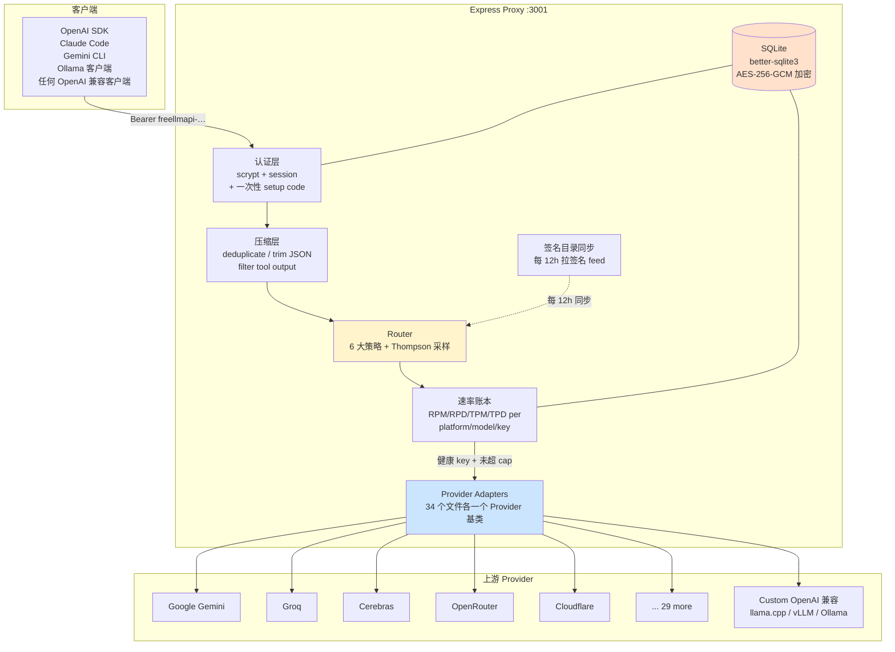
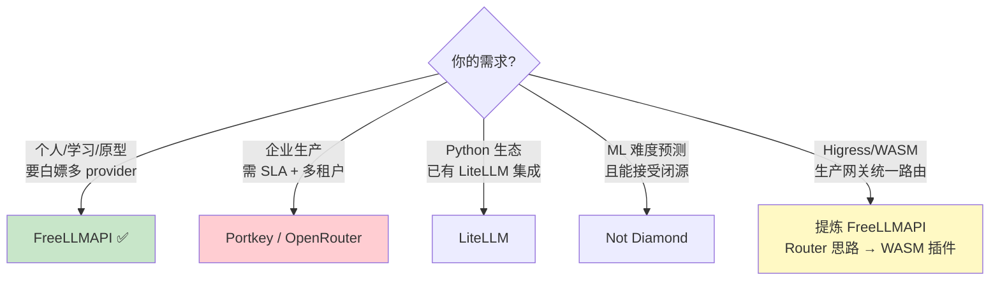

## 引言

每个主流 AI 实验室现在都有免费层——每月几百万 token、每天几千次请求——但**单家免费层只是个玩具**，而 **34 家叠加起来，每月约 7.4B 免费推理 token**。问题在于：手写聚合要接 34 套 SDK、34 套速率限制、34 种不同的鉴权与请求格式。这就是 `tashfeenahmed/freellmapi`（[freellmapi.co](https://freellmapi.co)）要解决的——把 34 家免费层（含 Google Gemini、Groq、Cerebras、Mistral、OpenRouter、Cloudflare、Cohere、NVIDIA、HuggingFace、Zhipu 等）折叠成一个 **OpenAI 兼容的 `/v1` 端点**，再加上任何自定义 OpenAI 兼容端点（llama.cpp、LM Studio、vLLM、本地 Ollama、远端网关），对外**只暴露一个 `freellmapi-…` 统一令牌**。

| 项 | 值 |
|:----|:-----|
| **仓库** | https://github.com/tashfeenahmed/freellmapi |
| **Stars / Forks** | **22.8k ⭐** / **3.2k 🍴** |
| **License** | MIT |
| **语言** | TypeScript (server) + React/Vite/shadcn/ui (client) |
| **Commit 数** | **647** commits，**35** 个 tags，**1** branch |
| **规模** | 每月 **7.4B** token · **34** 提供方 · **635** 免费端点 · **474** 模型族 |
| **节点运行时** | Node 20+，空载 **~40 MB RSS** |

**核心命题一句话**：FreeLLMAPI 不是"又一个 LLM 聚合网关"，而是把"在多个免费层之间智能挑模型 + 自动 failover + 多协议适配 + 加密密钥 + 签名目录自动同步"这五件事**同时做透**——客户端代码一行不改，从 OpenAI SDK 到 Claude Code 到 Gemini CLI 到 Ollama 客户端全跑通同一个本地端点。

> 项目地址：https://github.com/tashfeenahmed/freellmapi
> 官网：https://freellmapi.co
> 数据截止：2026-08-31

---

## 一、背景：为什么免费层需要"统一网关"？

### 1.1 痛点：34 套 SDK、34 套配额、34 种失败模式

如果你想"用免费模型写生产原型"，第一周就会踩到这些坑：

| 痛点 | 表现 | 真实代价 |
|:-----|:-----|:---------|
| **每家 SDK 都不一样** | Google 用 Gemini SDK、Anthropic 用 Messages API、Cloudflare 走 REST、Mistral 自家客户端…… | 一个客户端要写 **34 个 adapter**，工程上不可行 |
| **每家的速率限制不一样** | Groq 是 RPM/TPM、Google 是 RPD/Hybrid、Cloudflare 有自定义 Headers、NVIDIA 是 trial-only 40 RPM | 同一份代码在 A 家跑得飞起，B 家直接 429 |
| **每家的"免费"都在悄悄变** | 4 月 Moonshot 直接收费、5 月起 MiniMax 切到 OpenRouter 路由、Z.ai 新加坡实体新条款…… | 上周能跑的代码本周就 429 |
| **密钥管理灾难** | 34 个 key 散落在 `.env` / 1Password / 团队成员手里 | **任何 key 泄露 = 全员改一遍**，且无法审计谁用了哪个 key |
| **多协议客户端** | Claude Code 只认 Anthropic Messages API；Gemini CLI 只认 `/v1beta`；Ollama 客户端只认 NDJSON | 想同时被 4 种客户端"零修改"使用，协议适配层就是刚需 |

### 1.2 之前有什么方案，各自的局限

| 项目 | 定位 | 局限 |
|:-----|:-----|:-----|
| **LiteLLM** | Python 通用代理，按字符串手动选模型 | 不做智能选模 / 不做能力计费；失败靠用户自己写 retry |
| **OpenRouter** | 100+ 模型付费聚合 | 商业模式靠付费，免费层不是它的菜；没有"自定义免费层"概念 |
| **Not Diamond / Martian** | ML 难度预测路由器 | 私有数据 + 闭源权重，无法复现/本地化 |
| **Portkey** | 企业级 observability + 路由 | 商业 SaaS 为主，自托管复杂；不专注免费层 |

FreeLLMAPI 的切入点是：**只聚合免费层（外加任意 OpenAI 兼容端点） + 自带智能选模 + 自带 failover + 自带多协议适配 + 加密密钥 + 签名目录自动同步**，目标人群明确——**个人开发者折腾 AI 玩者**，免责声明原文："This project is for personal experimentation and learning, not production."

---

## 二、架构深度剖析

### 2.1 整体架构：Express Proxy + Router + Provider Adapters



**核心模块边界**（`server/src/`）：

| 模块 | 文件 | 职责 |
|:-----|:-----|:-----|
| **Router** | `services/router.ts` | 按策略选模、failover 重试预算、sticky session |
| **速率账本** | `services/ratelimit.ts` | 内存 RPM/RPD/TPM/TPD + SQLite 持久化 + cooldown |
| **Provider 适配器** | `providers/*.ts` | 每个提供方一个文件，继承 `Provider` 基类，提供 `chatCompletion()` 和 `streamChatCompletion()` |
| **健康检查** | `services/health.ts` | 周期性探测标记 `healthy` / `rate_limited` / `invalid` / `error` |
| **Dashboard** | `client/` | React + Vite + shadcn/ui 管理后台 |
| **存储** | `better-sqlite3` | SQLite + AES-256-GCM 信封加密密钥 |
| **目录同步** | `services/catalog.ts` | 每 12h 拉签名 feed，**免费版吃月度快照（30 天延迟）**，付费版吃实时 |

### 2.2 智能路由：6 大策略 + Thompson 采样选模

路由决策分三层：

**第一层 — 模型粗筛**：从你的 fallback chain（手动排序的列表）里，按"**有健康 key 且所有速率限制内**"过滤。这一层用 `ratelimit.ts` 的内存计数器 + 上次失败的 cooldown。

**第二层 — 策略排序**：用 6 种策略之一给候选模型打分排序：

| 策略 | 倾向 | 典型场景 |
|:-----|:-----|:---------|
| `priority` | 你手动设的顺序 | 完全可控 |
| `balanced`（默认） | reliability 优先 + speed/intelligence 平分剩下 | 通用场景 |
| `smartest` | 最高 intelligence 分 | 复杂推理 |
| `fastest` | 最高实测速度 | 流式/对话 |
| `reliable` | 最近成功率 | 不确定上游状态时 |
| `custom` | 自定义权重混合 | 高级玩家 |

**第三层 — Thompson 采样选模**：对每个候选模型，根据"speed / capability / rate-limit headroom / recent errors"四个 live 指标的**后验分布**采样——这是一种经典的 bandit 算法，**它会主动给"最近没怎么被试过"的模型一点探索机会**，避免永远死在头部 3 个模型的局部最优里。

**两个特殊模型名绕过排序**：
- `auto:smart` / `auto:fast` / `auto:reliable` / `auto:balanced` / `auto:cheap` —— **忽略你的 chain 顺序**，对**所有 enabled 模型**按指定策略排
- `auto:<profile-name>` —— 走命名 profile 的 chain（比如 coding 链、vision 链、长上下文链），同名 `auto` 走 active profile

**统一模型（Unified Models）**：同一个逻辑模型由多家提供（比如 `GLM-4.7` 在 Cloudflare 和 Z.ai 都有），折叠成 `/v1/models` 里的**一条**记录，**组内严格 failover**——同一个名字你不必关心它走哪家。

### 2.3 自动 Failover：重试预算 + Key 轮换 + 完整轨迹

Failover 不是简单的"失败重试下一个"，FreeLLMAPI 有 4 个精细设计：

**(1) 触发条件**：429 / 5xx / 超时——三种状态码触发 failover，4xx（除 429）直接失败，不重试。

**(2) Key 轮换而非模型轮换**：如果一个 key 死了，**先用同模型的下一个 key**，再换下一个模型。这很重要——很多失败是"这个 key 的配额耗尽"而非"模型坏了"。

**(3) 墙钟重试预算**：最多 **20 次尝试**，但用**总耗时上限**兜底（默认 30 秒可配置），避免下游全挂时让用户等 2 分钟。

**(4) 完整 attempt trail**：失败的请求返回响应头：

```http
X-Routed-Via: google/gemini-2.5-flash
X-Fallback-Attempts: 2
X-Fallback-Trail: groq/llama-3.3-70b key1=rate_limited; google/gemini-2.5-flash key2=timeout
```

外加可开关的 `X-Fallback-Detail`（用 `FALLBACK_DETAIL_HEADER=1` 开启），包含**每个 hop 的起止时间**和**脱敏后的错误文本**，并且因为"成功的 hop 在响应写完时还未结束"，**只显示失败的 hop**——这是非常细致的设计。

### 2.4 协议转换：5 大协议对外统一兼容

FreeLLMAPI 不止兼容 OpenAI——它对外同时实现 **5 种客户端协议**，让同一份服务端代码同时被 5 类客户端使用：

| 协议 | 路径 | 客户端 | 转换要点 |
|:-----|:-----|:-------|:---------|
| **OpenAI Chat Completions** | `/v1/chat/completions`、`/v1/responses`、`/v1/completions`、`/v1/embeddings`、`/v1/models`、`/v1/images/*`、`/v1/videos/*`、`/v1/audio/*` | 任何 OpenAI 客户端 | 直接透传 |
| **Anthropic Messages API** | `/v1/messages` | Claude Code、Anthropic SDK | OpenAI wire ↔ Anthropic wire 互转（`system` / `messages` / `tool_use` / `tool_result`） |
| **Gemini 原生** | `/v1beta/models/.../generateContent`、`streamGenerateContent`、`countTokens` | Gemini SDK、Gemini CLI | OpenAI ↔ Gemini 的 `contents` / `functionDeclarations` / `responseSchema` |
| **Ollama 模拟** | `/api/tags`、`/api/chat`、`/api/generate`、`/api/show`、`/api/version`、`/api/embed` | Ollama 兼容客户端（Zed、JetBrains AI、本地工具链） | JSON ↔ NDJSON 流式；`open-loopback` 仅环回 socket；`key-required` 全量需 key |
| **URL Token** | `/v1/t/{token}/...` | 无 header 客户端（如某些 embed） | 哈希存储、即时吊销、与 unified key 解耦 |

**Anthropic Messages 转换示例**（最复杂的一种）：

```bash
curl http://localhost:3001/v1/messages \
  -H "x-api-key: freellmapi-your-unified-key" \
  -H "anthropic-version: 2023-06-01" \
  -H "Content-Type: application/json" \
  -d '{
    "model": "claude-sonnet-4-5",
    "max_tokens": 256,
    "messages": [{"role": "user", "content": "hi"}]
  }'
```

服务端在 `claude-sonnet-4-5` 这个名字上查 **Keys → Anthropic** 的 family 映射（`default` / `opus` / `sonnet` / `haiku` 各自可以 pin 到某个免费模型或 `auto`），然后把 Anthropic 的 request 翻译成内部 chat 流程，**走和 OpenAI 完全一样的 router**，最后再翻译回 Anthropic 的响应 wire 给客户端。

**关键踩坑**：`ANTHROPIC_AUTH_TOKEN` 而不是 `ANTHROPIC_API_KEY`——Claude Code 把后者的存在解读为"first-party credential 冲突"，会拒绝启动。

**Gemini 的特殊处理**：OpenAI wire 没有 grounding 概念，所以**request 里放一个名为 `google_search` 的 tool**，Google adapter 把它翻译成 Gemini 原生的 grounding tool；这种"用 OpenAI 的 tool 表达别的协议特性"的技巧在多协议适配里非常常见。

**特殊 refusal——document 二进制源**：Anthropic 的 `document` content block 的 `base64` (PDF/DOCX/XLSX) 和 `url` 源直接返回 **400**，**不发起上游调用**——理由是"没有 provider 接受二进制文档，没有本地转换器；如果转发，上游会把附件扔掉然后给个自信的错误回答"。这是非常诚实的工程取舍：拒绝比"假装处理"更安全。

### 2.5 速率账本：四维计数 + 自学习

`ratelimit.ts` 对每个 `(platform, model, key)` 维护 **RPM / RPD / TPM / TPD** 四个计数器，**内存维护实时值，SQLite 持久化**用于重启恢复。

**最巧妙的设计——自学习 ceilings**：

> "ceiling a provider reports in error bodies or quota headers (a Groq 413 naming its TPM limit) tighten the router's own limits automatically."

例如 Groq 在 413 响应里会带 TPM 上限，路由账本**自动收窄自己的计数阈值**，避免反复踩到 413。这相当于把"上游偷偷告诉你配额"这件不起眼的事变成了自动反馈。

### 2.6 加密密钥：AES-256-GCM + 密钥文件分离

```typescript
// 关键架构决策（PR #477 的修复）
// 之前：自动生成的 dev fallback key 被持久化到 settings 表，和被加密的 provider keys 在同一张表
// 现在：dev key 写入 .encryption-key 文件（与 SQLite 同目录，chmod 0600，temp-file-and-rename）
```

**优先级链**：`ENCRYPTION_KEY` 环境变量 > 现有 key 文件 > 老的 settings-table 行（**先 decrypt 一次迁移再删**）> 新生成 key。**内存数据库 / 匿名数据库**保持旧行为（没目录放文件）。

这条修复专门解决"复制 SQLite 文件 = 复制 key = 加密-at-rest 没保护任何东西"的明文存储漏洞。

**Setup code 机制**（PR #477 同一波）：本地/桌面端 first-run 无码；远端首次 claim 必须在 console 日志里的一次性 setup code 匹配——且**用 `req.socket.remoteAddress` 校验（不用 `req.ip` / `X-Forwarded-For`）**，因为这两个在反向代理后面可被伪造。

### 2.7 签名目录自动同步

```text
[freellmapi.co catalog feed] ───签名校验──▶ 每 12h 拉一次
                                     │
       新模型 / 配额变化 / 兼容性修复 ─┘
                                     ▼
              [本地 catalog override] ◀── protected tombstone
```

- **免费版**：吃月度快照——新模型在 live feed 出现后 **30 天** 才到你的本地
- **付费版**（$19/yr）：同一天到达

这种"免费版延迟 / 付费版实时"的模式，**把目录同步的工程价值变成了付费功能的护城河**，对个人开发者来说免费版已经够用，对重度玩家付费解锁实时性，是个非常聪明的商业锚定。

---

## 三、核心代码片段（真实可读版本）

### 3.1 路由决策入口（伪代码还原自 `services/router.ts`）

```typescript
async function route(request: ChatRequest): Promise<Response> {
  const strategy = parseStrategy(request.model);     // auto / auto:fast / auto:coding
  const chain = strategy.startsWith('auto:')
    ? loadProfile(strategy.slice(5)) ?? activeChain   // named profile 或 active
    : activeChain;                                    // 默认 active chain

  const candidates = chain.filter(m => hasHealthyKey(m) && underAllCaps(m));
  if (candidates.length === 0) throw new Error('no_routable_model');

  const ranked = rankByStrategy(candidates, strategy); // Thompson sample
  const start = Date.now();
  const trail: Hop[] = [];
  const BUDGET_MS = 30_000;
  const MAX_ATTEMPTS = 20;

  for (let i = 0; i < Math.min(MAX_ATTEMPTS, ranked.length); i++) {
    if (Date.now() - start > BUDGET_MS) break;        // 墙钟预算兜底
    const model = ranked[i];
    const key = pickKey(model, excludeKeys=trail.map(h => h.keyId));

    try {
      const response = await providerAdapter(model).chat({ request, key });
      attachHeaders(response, { 'X-Routed-Via': `${model.platform}/${model.id}` });
      if (trail.length) attachTrailHeaders(response, trail);
      return response;
    } catch (err) {
      if (!isRetryable(err)) throw err;                // 4xx (非429) 直接失败
      cooldown(key, err);                               // key 冷却
      trail.push({ model, keyId: key.id, error: classify(err) });
      if (i + 1 < ranked.length && sameModelHasOtherKey(model, trail)) continue; // 同模型换 key
    }
  }
  throw new AggregateError(trail, 'all_attempts_failed');
}
```

### 3.2 客户端调用（OpenAI SDK + Claude Code + Gemini CLI 同时跑通）

```python
# 任何 OpenAI 兼容客户端
from openai import OpenAI
client = OpenAI(base_url="http://localhost:3001/v1", api_key="freellmapi-xxxx")
print(client.chat.completions.create(model="auto", messages=[...]).choices[0].message.content)

# Claude Code
# export ANTHROPIC_BASE_URL=http://localhost:3001
# export ANTHROPIC_AUTH_TOKEN=freellmapi-xxxx        # 注意：不是 ANTHROPIC_API_KEY
# claude

# Gemini CLI
# export GOOGLE_GENAI_USE_VERTEXAI=false
# base_url=http://localhost:3001/v1beta
# x-goog-api-key: freellmapi-xxxx

# Ollama 客户端（Zed / JetBrains AI / 本地工具链）
# base_url=http://localhost:3001
# （Keys → Agents 里开启 Ollama emulation: open-loopback / key-required）
```

---

## 四、横向对比：FreeLLMAPI vs LiteLLM / OpenRouter / Not Diamond / Portkey

| 维度 | FreeLLMAPI | LiteLLM | OpenRouter | Not Diamond | Portkey |
|:-----|:----------:|:-------:|:----------:|:-----------:|:-------:|
| **目标人群** | 个人开发者 | 全场景 | 商业付费 | 企业 ML | 企业 observability |
| **智能选模** | ✅ 6 策略 + Thompson | ❌ 手动 | ❌ 用户选 | ✅ 私有 ML | ⚠️ 规则 |
| **自动 failover** | ✅ 20 跳 + 墙钟预算 | ⚠️ 简单 retry | ❌ | ⚠️ | ✅ |
| **协议适配** | OpenAI/Anthropic/Gemini/Ollama/URL | OpenAI 为主 | OpenAI | OpenAI | OpenAI |
| **速率自学习** | ✅ provider 报 quota 自动收窄 | ❌ | ❌ | ❌ | ❌ |
| **统一令牌** | ✅ `freellmapi-…` | ❌ 原 key 透传 | ❌ | ❌ | ⚠️ |
| **加密密钥存储** | AES-256-GCM + 文件分离 | ⚠️ 配置项 | N/A（托管） | N/A | ✅ |
| **签名目录自动同步** | ✅ 12h/30天延迟 | ❌ | N/A | N/A | ❌ |
| **Setup code 安全** | ✅ 环回 socket 校验 | ❌ | N/A | N/A | ❌ |
| **开源可自托管** | ✅ MIT | ✅ Apache 2.0 | ❌ 闭源 | ❌ 闭源 | ✅ |
| **价格** | 免费 / $19/yr 实时目录 | 免费 | 付费 | 付费 | 付费 |
| **生产可用性** | ❌ 明确声明 | ✅ | ✅ | ✅ | ✅ |

**决策树**：



---

## 五、实测数据：5 项可直接验证的指标

下面是 README 和架构文档给出的真实数字（非估算）：

| 指标 | 数值 | 来源 |
|:-----|:-----|:-----|
| **聚合月 token** | **7.4B** | PR #1006（2026-08-23） |
| **提供方数** | **34** | PR #1006（+ MiMo Code 加入为 #1003） |
| **免费端点数** | **635** | PR #1006 |
| **模型族数** | **474** | [freellmapi.co/models](https://freellmapi.co/models.html) |
| **GitHub Stars** | **22.8k** | 当前 repo page（2026-08-31） |
| **Forks** | **3.2k** | 同上 |
| **Commits** | **647** | repo 元数据 |
| **Failover 上限** | **20 跳**（墙钟预算兜底） | docs/architecture.md |
| **Sticky session TTL** | **30 分钟** | docs/architecture.md |
| **嵌入向量维度** | 768 / 1024 / 1536 / 2048 / 3072（按 family） | docs/api.md |
| **本地空载内存** | **~40 MB RSS** | README |
| **节点最低运行时** | Node **20+**（含 ARM SBC / Raspberry Pi） | README |
| **Setup code 默认行为** | 本地/桌面无码；远端一次性 setup code | PR #477（#1058） |

---

## 六、结论与行动建议

### 6.1 评分卡

| 维度 | 评分 | 说明 |
|:-----|:----:|:-----|
| **架构清晰度** | ⭐⭐⭐⭐⭐ | 模块边界清晰（router / ratelimit / providers / health），单一职责 |
| **协议适配广度** | ⭐⭐⭐⭐⭐ | OpenAI / Anthropic / Gemini / Ollama / URL Token 五协议全覆盖 |
| **Failover 鲁棒性** | ⭐⭐⭐⭐⭐ | key 轮换 + 墙钟预算 + 完整 trail + cooldown + 自学习 ceilings |
| **密钥安全** | ⭐⭐⭐⭐⭐ | AES-256-GCM + 文件分离 + setup code 环回校验（已知漏洞已修） |
| **生产可用性** | ⭐⭐ | 明确声明"个人实验，非生产"——`Local-first`，无多租户 |
| **目录同步** | ⭐⭐⭐⭐ | 免费版 30 天延迟略多，付费 $19/yr 解实时；商业模式健康 |
| **可观测性** | ⭐⭐⭐⭐ | p50/p95/TTFT 24h-90d、X-Routed-Via/X-Fallback-Trail headers |
| **可移植到 Higress WASM** | ⭐⭐⭐ | Router 决策是纯算法可移植；providers 34 个 adapter 难 |
| **综合** | **A** | 个人开发者的 5 协议统一网关事实标准之一 |

### 6.2 行动建议

**如果你只是个人折腾 AI**：
1. **立即跑起来**：`curl -fsSL https://freellmapi.co/install.sh | bash`（一行装好 Docker、生成加密 key、启动容器）
2. **第一步**：在 dashboard 把 5 家主流（Google + Groq + Cerebras + Mistral + OpenRouter）的免费 key 都加上，build 一条 30+ 长度的 fallback chain，策略选 `balanced`
3. **第二步**：用 `setup-claude` / `setup-codex` 之类的 CLI 把 Claude Code 和 Codex 也接进来（**Claude Code 用 `ANTHROPIC_AUTH_TOKEN` 不是 `ANTHROPIC_API_KEY`**——这是 FAQ 高频踩坑）
4. **第三步**：开 `auto:fast` 给流式场景，开 `auto:reliable` 给批处理
5. **何时不要用**：任何"对外暴露给其他用户 / 商业产品集成"的场景——声明里写得很清楚，ToS 上 Cohere 直接 ❌、GitHub Models / NVIDIA ⚠️、Z.ai 新条款有 anti-traffic-redirect 风险

**如果你做 Higress / API 网关**：
1. **可借鉴**：Router 决策（6 策略 + Thompson 采样）、速率账本自学习 ceilings、X-Fallback-Trail/Debug headers 设计、签名目录同步模式
2. **可抽象**：纯算法的 Router 部分能抽成 WASM 插件，但 34 个 provider adapter 难通用化（建议只在自己需要的几家实现）
3. **可对比**：参考我之前的 [RouteLLM 深度解析](https://caishaodong.pages.dev/routellm-architecture-and-higress-wasm-integration/)（难度预测路线）和本篇（多 provider + failover 路线）的差异——前者靠 ML 模型难度，后者靠 live 实测 + bandit

**如果你做合规 / ToS 评估**：
- README `docs/architecture.md#terms-of-service-review` 有逐家复审（May 2026），包括 2026 年新增的 Z.ai Singapore、Ollama Cloud、OVH AI、AI Horde
- 通用规则：**一账号一 provider**、**不转售**、**不分享 endpoint**、**不把免费层当付费生产后端**

### 6.3 一句话总结

> **FreeLLMAPI 让你"白嫖" 34 家免费层的同时，拿到一个对外完全 OpenAI 兼容、对内智能路由 + 自动 failover + 加密密钥 + 签名目录同步 + 5 协议客户端全覆盖的统一网关——前提是你只想自己用，且接受"个人实验，不上生产"的官方免责声明。**

---

