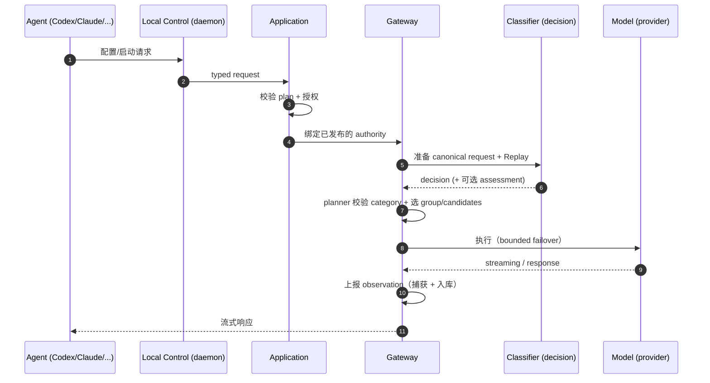

## 引言

[Higress 团队开源的 HiRoute](https://github.com/higress-group/HiRoute) 把自己定位为「**长程 Agent 任务的本地优先路由与协作引擎**」，slogan 是「**Route agents by task. Route models by stage.**」。0.2.0 稳定版（2026-10-08 发布）把决策模型内置进产品、把 Agent 集成从少数扩到多个，并把 macOS Desktop DMG + Linux headless CLI/daemon 的双架构包正式发了出来。

| 项 | 值 |
|:----|:-----|
| **仓库** | https://github.com/higress-group/HiRoute |
| **License** | Apache-2.0 |
| **主分支** | `main` |
| **Topics** | `model-routing`, `task-routing` |
| **最新发布** | 2026-10-08 · HiRoute 0.2.0（stable，macOS/Linux x86_64+ARM64） |
| **技术栈** | Rust workspace（edition 2024，rust 1.88+） + Tauri Desktop（Node 24） + Astro 网站（Node 22） |
| **协议契约** | Decision API v1（OpenAPI 3.1） |

**核心命题一句话**：HiRoute 不抢「执行 Agent」的位置，而是坐到你已经在用的 Agent（Codex / Claude Code / Qoder / Pi / DeepSeek Harness / DSH）和你的模型来源（订阅、API Key、自建兼容端点）之间，按 plan 在每个新用户 turn 重新判断「这一段活应该交给哪个模型组」。它的卖点不是「又一个 LLM 网关」，而是「**把整段长程任务切成多个阶段，每个阶段用最合适的模型**」。

> 项目地址：https://github.com/higress-group/HiRoute
> 官网：https://hiroute.ai
> 数据截止：2026-10-10（基于 0.2.0 release + main 分支当前文档）

---

## 一、背景：为什么需要「按阶段选模型」？

### 1.1 长程 Agent 任务的真实形态

一次典型的开发 / 写作 / 研究任务很少能用一个模型「一气呵成」：

- **研究阶段**：需要广覆盖、低成本，对单条质量容错大
- **设计 / 决策阶段**：需要强推理，对单条准确性容错小
- **实现阶段**：需要长上下文 + 代码能力
- **修复 / 验证阶段**：需要诊断 + 推理 + 多文件协同

把整段任务都交给最强的模型，每一步都在烧订阅额度；全用便宜模型，关键决策容易翻车。**理想的做法是按阶段切，按需调度**——但手动切换成本高、容易遗漏。

### 1.2 之前有什么方案？各自的局限

| 方案类型 | 代表 | 局限 |
|:---------|:-----|:-----|
| LLM 网关 / 聚合器 | FreeLLMAPI、9Router、LiteLLM | 路由粒度停留在「按模型名」或「按账号」，不做任务阶段判断 |
| Higress WASM 插件 | Headroom、OpenSquilla、RTK | 主要做压缩 / 推理优化，仍是「一个请求 → 一个模型」 |
| Claude Code / Codex 内置路由 | 各家 CLI 自带的 model picker | 路由策略写死在客户端，跨客户端不通用，且不区分阶段 |

HiRoute 想补的是中间这一块：**让一个本地引擎托管路由决策，把 Agent 当成「执行外壳」，模型当成「可调度的资源」**。

### 1.3 设计原则（一句话）

> **Competence blocks risky cost-cutting; complexity creates opportunities to save.**

翻译过来就是：**胜任度阻止冒险降本，复杂度反而提供省钱空间**。具体落地是：

1. 用「决策模型」判断当前任务是「简单」还是「复杂」
2. 用上一阶段的「胜任度评分」拦住低质量路径
3. 在保证质量的前提下，复杂任务里也有便宜模型能干的子环节

---

## 二、整体架构：分层 + 控制路径

### 2.1 控制路径（CLI/Desktop → 模型）

```
CLI/Desktop
  └─ client-core (共享 client 行为)
       └─ daemon control (Local Control)
            └─ Application (业务工作流 / Ports)
                 ├─ local-storage (持久化)
                 ├─ integrations (原生 Agent 配置)
                 └─ Gateway (执行)
                      └─ gateway-core (执行预算 / 取消 / 清理)
```

这条链路的精髓：**Application 只做编排，不做执行**——具体效果（持久化、调用原生 CLI 改文件、调上游 LLM）由 daemon control 提供具体 adapter 实现。这意味着你可以替换任意一个 adapter（比如换持久化后端、换 Agent 协议实现），但 Application 这层的 plan / decision / competence 语义不动。

### 2.2 Workspace 模块划分

`Cargo.toml` 的 `members` 直接列了 16 个 crate + 2 个 app + 2 个 e2e tool：

| Path | 责任 |
|:-----|:-----|
| `crates/domain` | 业务类型与不变式（typed intent、不可变 plan、operation checkpoint） |
| `crates/application-api` | Local Control 契约（CLI 与 Desktop 共享的请求/响应，typed producers 生成 schema） |
| `crates/application` | 业务工作流（编排 + 授权通过 ports，外部效果由 daemon 提供） |
| `crates/client-core` | 共享 client 行为 |
| `crates/daemon` | 组合 + 进程生命周期（含 `control/runtime`、`delegation`） |
| `crates/gateway`, `crates/gateway-core` | Agent-facing 协议、路由、执行、fallback |
| `crates/local-storage` | 持久化（checkpoint、journal、profile、worker 依赖等） |
| `crates/integrations` | 原生 Agent 集成（Codex / Claude / Qoder / Pi / DSH 等） |
| `crates/observation` | 业务证据（执行事实、会话查询、内容完整性、managed text） |
| `crates/diagnostics` | 独立的诊断（不进入业务证据流） |
| `crates/cpa-bridge` | CLIProxyAPI 桥接（让订阅流量进入路由） |
| `crates/desktop-host-effects`, `crates/host-runtime` | 桌面 host + 跨 runtime 抽象 |
| `apps/desktop`, `apps/website` | Tauri 桌面端 + Astro 双语站 |
| `tools/e2e-harness`, `tools/product-e2e`, `tools/release-facts` | 验证 + 发布产物 |
| `decision-extensions` | 决策模型指南、routing mechanism、扩展 API、可选 Jev 扩展示例 |
| `contracts`, `assets` | 运行时契约、模型元数据、产品资源 |
| `e2e`, `scripts` | 产品场景、打包与自动化 |

### 2.3 关键依赖

```
async-trait   clap (derive)   futures
aes-gcm       base64          bytes
h2 (HTTP/2)   fs2             getrandom
```

工程层面：edition 2024 + rust 1.88+，前端 Node 24（Desktop）/ Node 22（website）。

## 三、四种 Routing Modes 与决策机制

### 3.1 四种模式

| Mode | 决策模型干什么 | 候选组 |
|:-----|:-------------|:------|
| **fixed model** | 不调用决策 | 单模型固定 |
| **smart saving** | 判断当前任务是 simple / complex（输出概率分布） | economy + primary 两个组 |
| **custom branches** | 先选 task category，再选 category 内的 simple/complex | 每个 category 可配 regular + 可选 primary |
| **free first** | —— | 优先使用免费 provider，失败再回退 |

`group_policy.rs` 注释明确写了：**「per-turn two-group policy. No persistent upgrade cursor or parallel execution state.」**——即每次新用户 turn 都重判，不在状态里记「下次直接升级到 primary」这种 cursor。

### 3.2 smart saving 的核心公式

来自 `decision-extensions/README.md` 的字面描述：

> Economy is selected when this turn's simple-task probability meets your threshold and no applicable, complete assessment falls below the competence floor. Otherwise HiRoute selects primary.

两个阈值（默认值）：

| 阈值 | 默认值 | 作用 |
|:-----|:------|:-----|
| **simple threshold** | **0.8** | simple-task 概率达到这个值，才考虑选 economy |
| **competence floor** | **0.5** | 上一阶段完整胜任度评分低于这个，强制选 primary（保护质量） |

**关键边界**：

- **Missing / partial 评分保持 unrated**，不进平均值，也不当作 0
- 旧评分不会自动成为新评分，新 turn 重新判断
- 写文章的评分不会升级 review 任务（评分属于实际跑过的那一阶段）
- 「保留当前模型」优先只在**新选 group 内的合格模型**之间生效，不跨 group

### 3.3 custom branches 的判定顺序

```
1. 选择 task category (writing / review / ...)
2. 若该 category 有 primary 组，再选 degree (regular / primary)
3. 单组 category 跳过 degree 判定（仅 regular）
4. category 选不出来 → 走 plan 的 default category 的 primary 组
5. 整个 decision 失败：
   - smart saving → 用 heuristic rules
   - custom branches → 用 default category 的 primary
```

「重叠 condition」按当前请求的「主要意图」判，不按难度判——这点在文档里专门强调过。

### 3.4 bounded failover（核心安全边界）

| 起点 | 候选失败 | 可不可以 relay |
|:----|:--------|:-------------|
| regular | 失败 | ✅ 可 relay 到**同 category 的 primary** |
| primary | 失败 | ❌ 只在 primary 组内继续，耗尽则显式失败 |
| 单组 category | 失败 | ❌ 耗尽则显式失败 |

**failover 不创建 competence score**，也不改变 task category。这是很重要的设计选择——一次失败不应该污染后续决策。

## 四、Decision Models 与 Custom Extension 边界

### 4.1 两类决策来源

| 类别 | 怎么用 | 谁负责 provider 调用 |
|:----|:------|:------------------|
| **Built-in decision models** | Models → Decision models 里直接连接 Bailian / OpenRouter Jev / TypeSafe 等 | HiRoute 内置 adapter（System One 协议） |
| **Custom extension** | 同样的 UI 加，但 endpoint 是你自己 deploy 的 HTTP 服务 | 你自己（按 Decision API v1 契约） |

**内置版本不需要自建决策服务**——直接连供应商即可。Custom extension 是「需要接管推理、prompt 构造、context trim」的玩家用的，官方给了 [Jev 扩展示例](https://github.com/higress-group/HiRoute/tree/main/decision-extensions/extensions/jev-decider)。

### 4.2 Decision API v1 的契约（精简版）

- 一个 HTTP `POST`，JSON body，最多 64 KiB
- `decision.kind` 只有两种：`ordinal`（输出 simple/complex 概率分布）/ `categorical`（输出一个 category ID，可选带 refinement 的 ordinal）
- `assessment` 是**独立字段**，不是 `decision.kind` 的一种——表示「给上一阶段打个分」
- 三个关键 ID（`simple` / `complex` / category 名等）必须**精确匹配**，不能翻译或重命名
- HiRoute **不会**自己重试或 fallback 决策模型的失败（除非 source 仍然 active）——失败时按 plan 的 fallback policy 走

OpenAPI 文档位置：`decision-extensions/api/decision.openapi.json`，examples 在 `decision-extensions/api/decision-examples.json`。

### 4.3 决策时机：何时重判 vs. 何时复用

| 触发 | 行为 |
|:----|:-----|
| 每个新用户 turn | **强制重判** |
| 同 turn 内的工具续接（tool continuation） | **保持 frozen decision**（让模型复用增长中的上下文前缀） |
| Context rebuild 后无法识别续接 | 重判 |
| 重判后仍选同一模型 | 缓存复用取决于 provider |

这个设计很关键：**上下文前缀的复用（KV cache hit rate）是省钱的重要部分**——如果每个工具调用都重判 + 换 provider，前缀就废了。

### 4.4 内置决策模型的 System One 适配

`decision-extensions/api/system-one-design.md` 描述了内置 adapter 怎么把 System One 提供商的 wire 协议映射成 HiRoute 内部的 `model/state/questions` 适配器形态。**只有当遇到真正不兼容的协议时才需要新增 adapter**——光「provider 名不一样」不构成理由。

## 五、Gateway 执行：从请求到模型调用

### 5.1 请求生命周期

`crates/gateway/README.md` 把请求路径总结为一句话：

> Authenticate and bind authority, prepare the canonical request and Replay, obtain a request-owned branch decision, plan and freeze candidates, then admit execution into `hiroute-gateway-core`.



### 5.2 几个关键设计

**核心不执行第二遍**：Gateway 不另起一个执行循环——执行归 `gateway-core`，Gateway 只管「attempt / response commit / 取消 / 资源清理」。**控制权与执行权分离**。

**`TargetResolver` 只负责 DNS 和 dial mapping**，不读 credentials、不读 runtime-state stores。**解析一次、构造一次，后续不动**——避免 race condition。

**Protocol matrix**：Cross-protocol Messages renderers omit foreign reasoning without inventing signatures.——跨协议时不强发明签名/usage 字段，避免污染下游的计费和可观测性。

### 5.3 失败处理

| 失败类型 | Gateway 行为 |
|:--------|:------------|
| **Classifier 超时** | 可走 published failure policy（heuristic rules for smart saving / default category for branches） |
| **Source deadline / 客户端断连** | **不允许启动模型** |
| **Classifier transport failure** | 不允许 fallback 到 local rule（除非 source request 仍 active） |
| **Live publication cutover** | pin 每个请求到当时生效的版本，保留「last good version」 |

## 六、使用场景与典型工作流

### 6.1 场景 A：长程 Coding Agent 按阶段选模型

这是 HiRoute 的「杀手场景」。一次完整的 coding 任务通常包含：

```
research → design → implement → debug → review
```

用 HiRoute 的 smart saving 模式配置：

- **economy group**: Qwen-3.8 Flash（研究、改写、文档）
- **primary group**: GPT-6 Astra（架构决策、复杂 debug）

**官方实验数据**（`news/2026-10-04-astra-qwen.en.md`）：

> 在 messaging-system 设计评审任务中，两次 HiRoute mixed 运行相对 all-Astra 平均**省 91.39%–92.01%**，研究阶段检查准确率 99.03%，3/3 关键决策正确。
>
> 另一次 ~32 分钟的 coding 任务，economy 模型一直 research 没进 implementation，HiRoute 在 context handoff 自动升级模型；最终**通过 343 项独立检查**。

### 6.2 场景 B：写作 + 审稿（custom branches）

定义两个 category：

| Category | regular group | primary group | 评分场景 |
|:---------|:-------------|:-------------|:-------|
| **writing** | Qwen（结构 / 表达 / 资料整合） | GPT-6（深度论证） | 写完打分 |
| **review** | GLM（事实核查 / 遗漏） | GPT-6（深度审稿） | 审完打分 |

**关键点**：writing 阶段的评分**不会升级 review 任务**。审稿看到的「写作评分」只用于下一轮写作的 competence 保护，**不能作为审稿的路由依据**。

### 6.3 场景 C：自动升级（Context Handoff）

`crates/gateway/src/context_hold/store.rs` 实现了一个 ContextHold——把「exact route, version, protocol, authorization, session」绑定在一起。

| 行为 | 说明 |
|:-----|:-----|
| 同一 turn 工具续接 | 复用 ContextHold，**frozen decision 一直生效** |
| 上下文拼接重建 | 路由 / 版本 / 协议任一不一致 → 失效，重判 |
| 不相关的 plan publication | **不**让之前还活着的 ContextHold 失效 |
| 每个新请求 | 仍 reauthorize（不因为 ContextHold 存在就跳过授权） |

### 6.4 场景 D：Worker 委托（独立能力）

| 能力 | 含义 |
|:-----|:-----|
| **Task routing** | 主 Agent 通过 published plan 选择执行 Agent（Codex / Claude Code / Qoder / Pi / DSH） |
| **Worker 委托** | 把独立的研究 / 实现 / 测试任务分给另一个 Agent |
| **Read / Continue** | 读 Worker 结果 / 继续 Worker 任务 |
| **Cancel** | 显式取消（停止 != 成功完成） |

**Task routing**（按任务选 Agent）和 **Model routing**（按阶段选模型）是两个独立能力——可以单独用，也可以组合用。

## 七、Agent 生态集成方式

`docs/code-map/worker-context.md` 列了 5 个生态的差异——同样的「Worker 委托」在每个生态下的资源上下文、传输方式、历史处理都不一样：

| 生态 | 资源上下文 | 传输 | 历史处理 |
|:----|:---------|:-----|:-------|
| **Codex** | `HOME`/`CODEX_HOME` + project Skills | ACP adapter | 借用 native history，exact session |
| **Claude Code** | `HOME`/`CLAUDE_CONFIG_DIR` + project Skills | ACP adapter（受保护环境） | 借用 transcript，exact identity + flush |
| **Qoder** | `HOME`/`QODER_CONFIG_DIR` + project Skills | native ACP CLI | 借用 opaque history，exact ACP load |
| **Pi** | `HOME`/`PI_CODING_AGENT_DIR` + 项目 + 安装包 Skills | npm CLI + Node（bundled SDK→ACP bridge） | task-owned v3 transcript，**open 前 validation** |
| **DSH (DeepSeek Harness)** | `HOME`/`DSH_HOME` + project + custom Skill roots | native ACP CLI + public run patch | task-owned opaque history，exact ACP resume |

### 7.1 关键不变量

`docs/code-map/architecture.md#state-and-lifecycle-boundaries` 写了几个**绝对不能破**的不变量：

| 边界 | 不变量 |
|:----|:------|
| Agent settings | Configure/Edit seals before file tail；Ordinary Disable 条件性恢复，**冲突保留外部编辑** |
| Native target registration | 未使用的 discovered target **不是**访问权限或全局启动依赖 |
| Operation journal | checkpoint + journal 必须一致，**immutable plan bytes + generation/identity guards 是权威** |
| Worker/content lifetime | result 完成、process 停止、body 可用、Continue 权限是**独立的事实**——cleanup 需要精确 ownership |
| 恢复与兼容 | 当前 producer **共用一个 ingestion 契约**；legacy revoke tails 保留自己顺序 |

### 7.2 Pi 的 compatibility 是 capability contract

不是「能跑就行」，而是要满足 4 个 interface 需求：

| 操作 | 需要的 interface |
|:----|:---------------|
| **静态 import + 保存模型** | 不需要 Worker session API |
| **Collaboration（多 Agent 协作）** | native resource loader + read/bash/public CLI 路径 |
| **新任务** | provider/key binding + resources + new-session 接口 |
| **Continue** | native open + **exact supported transcript**；缺历史**不允许 fallback 到新建 session** |

冷启动 deadline：native version reads 10 秒，offline Pi SDK check 15 秒。超时**不**让 saved selection 失效，**不**消耗 submission key。

### 7.3 DSH 的静态组合

DSH 用静态 YAML patch sequence，**一个 `llm-pi-ai` row** 受影响。**Web profile 的 home row 优先级高于 hi-pi-ai row**——拒绝把 home provider row 调到会 shadow managed standard Web profile 的更高优先级。**绝不执行 JS / includes / plugins / credential helpers**。

## 八、模型来源：订阅 / 自建 API / Agent 接入

HiRoute 接受三类模型来源：

| 来源类型 | 怎么接 | 例子 |
|:--------|:------|:-----|
| **订阅（Subscription）** | 通过 CLIProxyAPI (CPA) bridge | Codex 订阅、Claude 订阅等 |
| **注册 API（registered API）** | 直接配 endpoint + API Key | OpenAI、Google AI Studio、自建 OpenAI 兼容 |
| **兼容 custom API** | 同上 + 可选 baseUrl 覆盖 | llama.cpp、LM Studio、vLLM、本地 Ollama、远端网关 |

`crates/integrations/src/agents/additional_native/README.md` 强调了几个**配路由时的硬规则**：

1. **每个 Plan 一 owned provider**——Plan 之间的 provider 不互相干扰
2. **Pi provider `baseUrl` 覆盖 inherited catalog**——但 explicit model 默认只受 provider `api` 影响
3. **DSH module replacement + credential-store precedence 留在 native leaf**，不挪进 generic provider merge
4. **Main-Agent 配置只加 Plan aliases**，native defaults / purpose routing / hooks / MCP / Skills 留给各 native owner
5. **Worker 用 transient profile**——独立 frozen route + 精确 budget
6. **Grant 加密 + mode 0600**，journal 不含 bearer 或 original native settings

主流程：

```
Models → Connect a model source
  → 选择 provider / endpoint / credential
  → 保存
  → Plan editor 里把模型分配到 economy / primary / regular 组
  → Publish
  → Agent 启动时通过 HiRoute 的 gateway connect_address 接进
```

## 九、桌面端 vs. Headless CLI/daemon

### 9.1 形态对比

| 维度 | macOS Desktop | Linux headless |
|:----|:-------------|:-------------|
| **包** | DMG（自签名需手动审批） | 用户级 tar.gz，**不需要 sudo** |
| **架构** | macOS 15+，Apple silicon `arm64` + Intel `x86_64` | Linux `x86_64` + ARM64 `aarch64` |
| **入口** | Tauri app + 系统托盘 | `hiroute`（CLI）+ `hirouted`（daemon） |
| **管理 Skill** | Desktop 自带 | `$HOME/.agents/skills/hiroute-management` + `$HOME/.claude/skills/hiroute-management`（自动放置） |
| **状态目录** | macOS 标准 Library | `${XDG_STATE_HOME:-$HOME/.local/state}/hiroute` |
| **安装脚本** | 拖到 Applications | `curl -fsSL https://hiroute.ai/install.sh \| sh` |

### 9.2 Standalone 安装的关键校验

`docs/standalone-cli.md` 里有一段非常严格的安全链：

> Before any write, the installer checks the platform, archive SHA-256, closed file set, and per-file digests. **Never infer an unpublished download URL from this page.**

具体安装步骤：

```bash
# 1. 安装
curl -fsSL https://hiroute.ai/install.sh | sh

# 2. 启动（**不自动启动**）
hiroute service start --output json

# 3. 验证 Local Control
hiroute service status --output json    # data.local_control_ready=true

# 4. 验证 daemon + gateway
hiroute system status --output json     # data.daemon=role_all, data.gateway=ready

# 5. 验证 gateway connect address
hiroute gateway show --output json      # data.ready=true, data.connect_address=...
```

**四个 readiness 标志同时为真才认为部署完成**。升级后**必须**显式 `hiroute service restart --output json` 把 daemon 切到新版本。

### 9.3 Skill 安装路径的安全约束

> The installer places the Skill in private, current-user-owned directories. A symlink, non-directory, foreign-owned, or group/world-writable Skill parent **aborts before any write**.

也就是说：Skill 父目录必须是「当前用户拥有的、不是符号链接的、普通目录、权限 0755 或更严」——任一不满足，安装在写任何东西之前就失败。这是个看似多余但很关键的反 symlink 攻击。

### 9.4 与 Desktop 互斥

> Installation fails if `/Applications/HiRoute.app`, `~/Applications/HiRoute.app`, or an active Desktop Local Control exists. Stop and uninstall standalone before switching in the other direction.

**Desktop 和 standalone 不能同时管同一个用户**——同 UID 的 Local Control 只允许一份。

## 十、可观测性：会话、competence、cost

### 10.1 关注点分离

| 关注 | 责任 owner | 调用方必须保持 |
|:----|:---------|:------------|
| **捕获完整性** | `crates/observation/src/content/completeness.rs` + session query | 聚合所有请求/方向；**流结束 ≠ session 完整** |
| **Streaming memory** | capture + pending delivery tracker | decoder / projector / delivery tracker 共用 stream budget；**queue 容量不是 capture 证据** |
| **Upstream fault attribution** | wire projection + attempt association + decision calls | 真实 bounded model/control 字段、negotiated HTTP 协议、closed error code、hashed request ID、**不要 prompt 或 provider error text** |
| **Search and gaps** | query + index worker + status | bounded scan windows + wraparound + 显式 gaps 区分「搜不到」和「未完成」 |
| **业务关系 / 可见性** | relation owner + managed content | `query_v2` 也写 relations；**每次 content read 检查当前授权和可见性** |
| **Decision / competence attribution** | decision observation map | 评分归到**实际跑过的那一阶段**，附 frozen category/group/candidate + rubric |

### 10.2 Plan quality

`apps/desktop/src/features/PlanQuality.tsx` + `crates/observation/src/query_v2/plan_quality.rs` 提供 stage 视图：

- 每个 stage 的 **实际 category / group / candidate 位置**
- 实际跑的模型 + reasoning 配置
- plan revision + frozen rubric
- **选择概率 / reason ≠ competence score**（一个解释为何选，一个评估跑得多好）

CLI 端通过 `observation plan-quality samples` 暴露同一查询（机器可读）。

## 十一、实验与公开证据

`experiments/` 目录下挂了 4 个 case study，全部「自包含、可独立复现」：

| Case | 问什么 | 入口 |
|:----|:-----|:----|
| **Research cost and quality** | 经济模型做研究 + 强模型做关键决策，能否在保证交付的前提下省钱？ | `python3 experiments/reproduce.py report` |
| **Unattended engineering** | native coding agent 能否在 context boundary 自动升级模型并通过独立验收？ | 准备 pinned HTTPX task，验证实现 |
| **Usage reconciliation** | smart saving 能否在变化的数据审计工作流上跑出更少的 token？ | `results/decision-routing-20261006/README.md` |
| **Writer and reviewer** | 写作 → Qwen、review → GLM 的分工能否比单独用任一模型更好？ | 同上的 blinded assessment |

**验证协议很硬**：

- 69 个 bulky JSON 走 Release attachment（SHA-256 pinned），**不进 git**
- `reproduce.py verify` 校验**原始 106-file checksum manifest**
- 离线检查 3,240 张卡 + 9 篇 memo + finding count + critical-memo findings
- Replay 公布的 unblinded review judgments（**不独立建立语义正确性**）
- 「新鲜 live runs」**和历史复现独立**——历史结果不替你证明 live 行为

简单说：这是「诚实的实验存档」——原始证据可校验，但声明只到「复现那一刻」为止。

## 十二、和 Higress / 其他 LLM Router 的关系

### 12.1 和 Higress 生态的关系

HiRoute 出自 [higress-group](https://github.com/higress-group)，但**不是** Higress 网关的插件，而是独立的本地引擎。两者解决的问题粒度不同：

| 工具 | 解决什么 | 粒度 |
|:----|:------|:----|
| **Higress 网关** | API/AI 网关，统一外部流量入口 | 请求级（HTTP route / upstream） |
| **Higress WASM 插件**（Headroom / OpenSquilla / RTK 等） | 压缩 / 转换 / 推理优化 | 单请求内部 |
| **HiRoute** | Agent 任务阶段路由 + 模型组调度 | **任务阶段级**（跨多次 LLM 调用） |

三者是**互补**关系：你可以把 HiRoute 跑在某个 agent 后端，把 Higress 跑在更外层做企业级流量治理。

### 12.2 和其他 LLM Router 的对比

| 项目 | 决策粒度 | 部署形态 | 强项 | 局限 |
|:----|:--------|:--------|:----|:----|
| **HiRoute** | **任务阶段 + 上一阶段 competence** | 本地引擎 + Desktop/CLI | 阶段路由 + 胜任度保护 + Agent 委托 | 不做协议翻译、不做账号降级 |
| **FreeLLMAPI** | 单请求按规则/Thompson 采样 | TypeScript server + Web UI | 34 家免费 provider 聚合 + 自动 failover | 不理解「阶段」 |
| **9Router** | 单请求 OpenAI 兼容聚合 | Next.js 本地 | 40+ provider + OAuth + RTK + Caveman | 不理解「阶段」 |
| **Nexus LLM Router** | 单请求智能路由 | 服务端 | 评分模型选模 | 任务阶段不在能力面 |
| **RouteLLM** | 研究框架 | Python | 矩阵分解 / BERT 选模算法 | 不绑定 Agent runtime |

**核心差异**：HiRoute 是为数不多的把「**competence 反馈回路**」（上一阶段评分 → 当前路由）作为一等公民的 router。其他多数 router 只在「选哪个」层面做事，不在「上一轮跑得好不好」层面做事。

## 十三、扩展边界与「何时不用 HiRoute」

### 13.1 HiRoute 明确**不**做

| 不做 | 替代 |
|:----|:----|
| 协议翻译（OpenAI ⇄ Anthropic ⇄ Gemini） | 让 Agent runtime 自己做 |
| 账号级降级 + 多账号轮询 | FreeLLMAPI / 9Router 更合适 |
| Prompt 压缩 / Token 优化 | RTK / Caveman / Headroom |
| 企业级流量治理 / 鉴权 | Higress 网关 |
| Tool subset selection（**协议文档有，无 runtime**） | 未来 |

README 里专门写了一句：

> Tool subset selection is **future protocol documentation only**; it has no supported runtime or product entry.

### 13.2 适合用 HiRoute 的场景

✅ 长程任务（multi-turn + 多工具调用 + 长上下文）
✅ 同一 Plan 里要混用「强模型」和「便宜模型」
✅ 订阅 + API Key + 自建兼容端点**多源**
✅ 已经在用 Codex / Claude Code / Qoder / Pi / DSH，想保留 CLI 工作流
✅ 关心「**关键决策不翻车**」的同时想省订阅额度
✅ 愿意写 decision extension（用内置 Jev/Bailian/TypeSafe 不需要）

### 13.3 不太适合 HiRoute 的场景

❌ 单轮短问答——overhead 比直接调 API 高
❌ 不在乎「哪个模型跑的」——只关心结果对
❌ 团队所有人必须用同一个模型——路由没意义
❌ 需要把 LLM 调用嵌入到生产 API 网关——那是 Higress 的活
❌ Windows——目前只发 macOS Desktop + Linux headless

## 十四、总结

HiRoute 用 Rust workspace + Tauri Desktop + Linux headless CLI/daemon 把「**长程 Agent 任务按阶段路由模型**」这件事做成了一等公民。它的核心价值不在于「又聚合了多少 provider」，而在于把三个常被混为一谈的能力**分得很清**：

1. **任务分类 / 复杂度判断**（由 decision model / custom extension 负责）
2. **模型组选择 + bounded failover**（由 group_policy + planner 负责）
3. **competence 反馈 + ContextHold 缓存**（由 observation + agent_turn_history 负责）

这三层**用不可变 plan、frozen category/group/candidate、replay-backed 决策历史**串起来，构成一条「**decision 是公开可审计的，competence 真的能影响下一轮**」的回路。

对于个人开发者和小团队：

- 不想折腾的：装 macOS Desktop / Linux headless，用内置 Jev/Bailian/TypeSafe 决策模型 + smart saving，3 步完成
- 想深度定制的：写一个 custom extension（HTTP service，按 Decision API v1 契约），可以接管 prompt 构造、context trim、甚至评分标准

对于 Higress 生态用户：

- HiRoute 是「**Agent 后端**」那一层，不是「**API 网关**」那一层
- 它和 Higress 网关、Headroom / OpenSquilla 等 WASM 插件**互补不替代**

「**Competence blocks risky cost-cutting; complexity creates opportunities to save.**」——这是 HiRoute 整个产品架构的设计哲学，也是它在「LLM Router」红海里值得单独看一眼的理由。

---

> **数据来源与引用边界**
> - 仓库元数据：https://github.com/higress-group/HiRoute（Apache-2.0, main 分支，2026-10-10 检视）
> - 架构与代码地图：`docs/code-map/README.md` / `architecture.md` / `decision-foundation.md` / `worker-context.md`
> - 决策契约：`decision-extensions/api/decision.openapi.json` + `decision-extensions/README.md`
> - 安装与发布：`docs/standalone-cli.md` / `docs/macos-installation.md`
> - 实验数据：`experiments/README.md` + `news/2026-10-04-astra-qwen.en.md`（Astra×Qwen 节省 91.39%–92.01% / 343 项独立验收）
> - **不在本文声称范围内的数据**：贡献者数量、客户名单、生产环境的真实使用规模——这些项目本身没有公开数据，请勿外推
> - Star / Forks 等快速过期的指标：本文未引用绝对值（取数于 2026-10-10）

