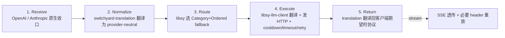

## 引言

[NVIDIA NeMo Switchyard](https://github.com/NVIDIA-NeMo/Switchyard) 把自己定位为「**open-source library that helps an AI agent choose which model handles each request**」，slogan 是把「**efficient + capable 模型组合 + 任务/阶段路由**」这件事做成可嵌入的 Rust 库。v0.3.0（2026-10 当前最新）把 `switchyard-runner` 从 server 抽出来给 NeMo Relay native plugin 用，引入 Advisor Gate、Composite、`auto` 预设、`reasoning_effort` per-target、`fallback_client` 转发非匹配请求，并把 host 驱动的 `Step::CallModel` / `Step::Done(RoutingOutcome)` 作为 0.3 唯一稳定的 API 形状。

| 项 | 值 |
|:----|:-----|
| **仓库** | https://github.com/NVIDIA-NeMo/Switchyard |
| **License** | Apache-2.0 |
| **主分支** | `main` |
| **当前版本** | v0.3.0（pre-1.0，README 明确写明「APIs, configuration, and routing behavior can change between releases」） |
| **技术栈** | Rust workspace（edition 2024，rust 1.96.1+） + Python 3.10+（PyO3 bindings `nemo-switchyard`）+ Nix-style Dockerfile |
| **Stars / 默认分支** | 3,349 ⭐（2026-10-11 检视） |
| **协议契约** | provider-neutral 内置 request/response 类型 + OpenAI/Anthropic 三种 wire format（`openai_chat` / `openai_responses` / `anthropic_messages`） |

**核心命题一句话**：Switchyard 不抢「AI Gateway」的位置，而是做成「**路由决策 SDK**」——把模型选择这件事从 proxy 拉回到 library 层，让任何 HTTP runtime（NeMo Relay、HiRoute 之类的 agent runtime、自研网关、Higress WASM 插件、Kong Go plugin）通过一段 Rust 代码就能拿到「下一个该由哪个模型服务这个 turn」的决策，自己负责发 HTTP、收 stream、做重试。

> 项目地址：https://github.com/NVIDIA-NeMo/Switchyard
> 数据截止：2026-10-12（基于 v0.3.0 + `main` 当前文档）

## 一、定位再确认：Switchyard 解决的「不是网关」的问题

| 工具类 | 代表 | 决策粒度 | 谁负责发 HTTP / 收 stream |
|:------|:----|:--------|:------------------|
| AI Gateway / OpenAI 聚合代理 | Higress `ai-proxy-multi`、Kong `ai-proxy-advanced`、OpenRouter、LiteLLM | 单个 HTTP 请求 | **网关自己** |
| Agent runtime | Codex / Claude Code / Qoder / Hermes Agent | 整轮 multi-turn | **runtime 自己** |
| **Switchyard** | **NVIDIA NeMo Switchyard** | **Agent 内部的「每一 turn / 每一 stage / 每一 judge call」** | **由 host 决定**（host 把 libsy 当 SDK 调用，自己实现 transport） |

README 原话把这条边界写得很死：

> Use Switchyard through a gateway integration, try it with a local proxy, or embed it in your own harness. **You choose the model pool. Switchyard supplies the routing decision. Your gateway or application owns the surrounding service.**

也就是说：

- `switchyard-server` 是「**托管形态**」——让你在没有 AI Gateway 的时候直接拿到一个 OpenAI / Anthropic 兼容的反代；
- `switchyard-libsy` 是「**SDK 形态**」——给你一段 Rust 代码，它告诉你「这一 turn 该用哪个模型、配上哪些 prompt」，HTTP 怎么发、stream 怎么收、密钥怎么取都交给 host。

这种定位带来一个直接后果：**Switchyard 不直接做网关**。它没有内置鉴权、没有 token 限流、没有可观测 dashboard、没有 WAF / prompt injection 检测、没有多租户计费。和 Higress / Kong 这类成熟 AI Gateway 比，它只做「**选模型这一件事**」。你把它集成进任何 AI Gateway，都可以视为「**给网关挂上了一个可热加载的、能跨 stage 思考的策略引擎**」。

## 二、Workspace 架构与 crate 边界

`Cargo.toml` 是这样组织的（成员列表来自根 `Cargo.toml` + `crates/` 子目录）：

```text
switchyard/                                       # 工作区根
├── Cargo.toml                                    # workspace + members
├── Cargo.lock
├── rust-toolchain.toml                            # 1.96.1 MSRV
├── pyproject.toml                                 # Python bindings (PyO3)
├── crates/
│   ├── libsy/                                     # ★ 路由决策 SDK（Beta）
│   ├── libsy-llm-client/                          # Alpha：HTTP transport
│   ├── protocol/                                  # provider-neutral DTO
│   ├── translation/                               # OpenAI ⇄ Anthropic ⇄ Responses codec
│   ├── runner/                                    # ★ TOML 驱动的 runner（Alpha）
│   ├── server/                                    # Demo：独立 OpenAI/Anthropic 兼容 proxy
│   ├── prefill-router/                            # 实验性 checkpoint-based router
│   ├── switchyard-nemo-relay-plugin/              # ★ NeMo Relay native plugin
│   ├── switchyard-py/                             # PyO3 binding（对外发 `nemo-switchyard`）
│   ├── switchyard-soak/                           # soak test runner
│   ├── switchyard-skill-distillation/             # CRAFT 任务生成（experimental/）
│   ├── switchyard-menubar/                        # macOS menu bar 实验
│   └── dynamo-preproc → 在 examples/dynamo-preproc # Dynamo SDK preprocessing 示例
├── examples/litellm/                              # LiteLLM routing plugin 示例
├── benchmark/                                     # Harbor Terminal-Bench Lite 复现
├── tests/                                         # cargo test + pytest
├── experimental/                                  # CRAFT 等研究工具
├── docs/                                          # mkdocs → 网站
└── dev-server/                                    # 本地开发 harness
```

### 2.1 各组件的稳定性与依赖方向

README 给出了一个非常明确的「稳定性梯度」：

| 组件 | Stability | 用途 | 推荐场景 | 备注 |
|:----|:---------|:----|:----|:----|
| `switchyard-libsy` | **Beta** | 在你自己的 gateway / harness 内部嵌路由 | 试验集成；v1.0 前 API 会变 | **★ Higress WASM / Kong Go plugin 的现实候选** |
| `switchyard-llm-client` | Alpha | HTTP 模型调用 + 协议翻译 + retry | 试验 / 试点 | 不强绑 libsy，可独立用 |
| `switchyard-runner` | Alpha | 在另一 runtime（NeMo Relay）内跑已配置 route | 集成 / 受控试点 | 0.3.0 从 server 抽出，**主要服务 nemo-relay-plugin** |
| `switchyard-server` | Demo | 单机的 OpenAI/Anthropic 兼容 proxy + Codex 本地服务 | 演示 / 评估 / 个人使用 | **不推荐生产** |

依赖方向是**单向底→顶**：

```text
            ┌────────────────────────┐
            │   switchyard-server    │  demo / 测评
            └────────────┬───────────┘
                         │
            ┌────────────▼───────────┐
            │     switchyard-runner  │  TOML → algorithm + 协议翻译 + fallback
            └────────────┬───────────┘
                         │
   ┌─────────────────────┼─────────────────────┐
   ▼                     ▼                     ▼
┌────────────┐    ┌───────────────┐    ┌──────────────────┐
│  libsy     │    │  translation  │    │  libsy-llm-      │
│  (routing  │◄──▶│  (OpenAI ⇄   │◄──▶│  client (HTTP    │
│   SDK)     │    │   Anthropic)  │    │   transport)     │
└─────┬──────┘    └───────────────┘    └──────────────────┘
      │                     │
      ▼                     ▼
┌────────────────────────────────────┐
│  protocol (provider-neutral DTO)   │
└────────────────────────────────────┘
```

`switchyard-nemo-relay-plugin` 直接 `use` `switchyard-runner` + `switchyard-protocol`：

```rust
// crates/switchyard-nemo-relay-plugin/src/lib.rs (节选)
use crate::runtime::SwitchyardRuntime;

impl NativePlugin for SwitchyardPlugin {
    fn plugin_kind(&self) -> &str { "nvidia.switchyard" }
    fn validate(&self, plugin_config: &Map<String, Json>) -> Vec<ConfigDiagnostic> { ... }
    fn register(&mut self, plugin_config: &Map<String, Json>, ctx: &mut PluginContext<'_>) -> ... {
        let config = parse_config(plugin_config)?;
        let runtime = Arc::new(SwitchyardRuntime::new(config)?);
        register_buffered(ctx, priority, Arc::clone(&runtime), plugin_runtime.clone())?;
        register_stream(ctx, priority, runtime, plugin_runtime)?;
        Ok(())
    }
}
```

### 2.2 `switchyard-libsy` 的公共 API 形态（SDK 核心）

`switchyard-libsy` 0.3 是**host-driven** 的——你（host）告诉它「这有一份 provider-neutral request + 一组候选 model」，它返回的是一连串 `Step`，让你**自己**决定什么时候去发 HTTP：

```rust
// 伪代码节选自 docs/getting_started.md + crates/libsy/src/lib.rs
use switchyard_libsy::{
    StageRouter, StageRouterConfig, Algorithm, Driver, RoutingOutcome,
    Step, StepStream, CallModel,
};

let algo = StageRouter::new(StageRouterConfig {
    picker: Picker::EfficientFirst,
    confidence_threshold: 0.5,
    capable_target: "anthropic/claude-sonnet",
    efficient_target: "openai/gpt-4o-mini",
    ..Default::default()
});

let mut driver = Driver::new(algo)
    .with_models(RuntimeModels {
        capable:  vec!["anthropic/claude-sonnet".into()],
        efficient: vec!["openai/gpt-4o-mini".into()],
        ..Default::default()
    });

while let Some(step) = driver.step().await {
    match step {
        Step::CallModel(CallModel { prompt, candidates, .. }) => {
            // host 决定怎么发 HTTP；libsy 不碰网络
            let resp = host_http.post(&candidates[0]).body(prompt).send().await?;
            driver.observe(resp).await?;   // 把响应喂回 libsy 继续决策
        }
        Step::Done(RoutingOutcome { selected_model_ids, metadata, .. }) => {
            // 拿到最终选择 + 证据 + outcome_id，去执行真正的「终端回答」调用
            host_serve(&selected_model_ids[0], metadata).await?;
            break;
        }
    }
}
```

关键类型（`crates/libsy/src/lib.rs` re-export）：

| 类型 | 角色 |
|:----|:----|
| `Algorithm` | 所有 algo 的 trait：`fn route(&self, Driver) -> impl Stream<Item = Step>` |
| `Driver` | 跑 algo 的状态机；包含 `RuntimeModels`（**algo 选 Category，Driver 决定 Category→Model 的映射**） |
| `Step::CallModel` / `Step::Done(RoutingOutcome)` | host 推进 run 的唯一接口（**0.3 强制收敛**，source-breaking） |
| `RoutingOutcome` | 最终结果：`selected_model_ids: Vec<ModelId>`（**有序**，fallback 顺序）+ `metadata: Option<OutcomeMetadata>` |
| `OutcomeMetadata` | `{ outcome_id, algorithm, evidence }`——evidence 是 bounded JSON，**不带 prompt/response/raw error** |
| `RuntimeModels` | 算法看到的「候选」视图，按 Category（`efficient` / `capable` / 任意自定义 group）组织 |
| `State` / `Event` | libsy 的可观测接口；`Event` 流配合 OTel subscriber 可写出 `libsy.run` span |

这是「**零网络**」的纯算法包——这是它能跑进 WASM 沙箱、跑进 Kong Go plugin、跑进自研 harness 的核心前提。

## 三、请求生命周期 + TOML 配置矩阵

### 3.1 五步生命周期

`docs/architecture.md` 给出了「**Receive → Normalize → Route → Execute → Return**」五步：



`docs/architecture.md` 把 backend wire format 写死了：

| `format` | 上游端点 | 说明 |
|:--------|:--------|:----|
| `openai_chat` | `/v1/chat/completions` | Chat Completions wire format |
| `openai_responses` | `/v1/responses` | OpenAI Responses API（含 freeform tools / Codex 兼容） |
| `anthropic_messages` | `/v1/messages` | Anthropic Messages API |

`format` **必填**，Switchyard **不探测**上游协议——每条 target 绑定一个 `format`，这是「**provider-neural 翻译**」的外接协议契约。

### 3.2 TOML 三段：llm_clients / targets / routes

最简配置（来自 `docs/reference/toml_schema.md`）：

```toml
schema_version = 1

[llm_clients.openrouter]
format            = "openai_chat"
base_url          = "https://openrouter.ai/api/v1"
api_key_env       = "OPENROUTER_API_KEY"
max_retries       = 2                       # 默认
failure_cooldown_ms = 5000                  # 默认 5s
timeout_ms        = 60000                   # 0.3 新增；置空则不限

# fallback_client：未匹配请求透传（不翻译、不读 body、不动 model id）
# fallback_client = "openrouter_passthrough"

[targets.weak]
id            = "openai/gpt-4o-mini"
llm_client    = "openrouter"
reasoning_effort = "low"                    # 0.3 新增：per-target 覆盖
# omit_body_fields = ["reasoning_effort"]    # 只在 openai_chat/responses 生效
# system_prompt = "..."                      # 0.3 新增：跟随 target

[targets.strong]
id            = "anthropic/claude-sonnet-4.5"
llm_client    = "openrouter"

[routes.smart]
id                    = "switchyard"
type                  = "auto"               # 0.3 引入 = stage_router(efficient_first, 0.5)
capable_target        = "strong"
efficient_target      = "weak"

[routes.composite]
id                    = "switchyard/composite"
type                  = "composite"
[routes.composite.classifier]
target                = "judge-target"      # 必填：tier judge，不是 final answer
base_threshold        = 0.6
threshold_step        = 0.05
classify_trigger      = "user_turn"
[routes.composite.stage]
capable_target        = "strong"
efficient_target      = "weak"
confidence_threshold  = 0.6
```

`schemas_version` 锁死为 `1`，`[llm_clients]` 可省（默认空），`[targets]` 和 `[routes]` **必须存在**（即使空），`schema_version` 必填——这是强契约。

### 3.3 Routing 路由类型全集

`docs/reference/toml_schema.md` 把 `routes.<name>.type` 的全集写出来，配合 `docs/routing_algorithms/overview.md` 一起读：

| `type` | 何时用 | 实现位置 |
|:-------|:------|:--------|
| `auto` | 「**默认就行**」 | preset：等价 `stage_router(efficient_first, 0.5)`，不调 classifier |
| `passthrough` | 不决策，只配 `target` + `subagents` | `libsy/algorithms/passthrough.rs` |
| `random` | 加权均匀随机 | `libsy/algorithms/rand.rs`，支持 seed |
| `llm_classifier` | judge 模型路由（capability / escalation / custom 三种 mode） | `libsy/algorithms/llm_class.rs` |
| `stage_router` | **核心**：按 tool signal + 阈值动态切 capable/efficient | `libsy/algorithms/stage.rs` |
| `plan_execute` | 在 able 上做 plan，切到 efficient 后执行 tool | `libsy/algorithms/plan_execute.rs` |
| `composite` | classifier 决定 stage 的 fall-open tier | `libsy/algorithms/composite.rs`（**0.3 新增**） |
| `advisor` | executor 服务 + advisor 终稿 review（APPROVE/REDO） | `libsy/algorithms/advisor_gate.rs`（**0.3 新增**） |
| `escalation_router` | llm_classifier `mode = "escalation"` 的特例 | libsy `util::escalation` |
| `prefill_router` | **实验性**，无 supported checkpoint / encoder | `crates/prefill-router/`，需 `--features prefill-router` |
| `noop` | 只回 `OK`，不发模型调用 | `libsy/algorithms/noop.rs` |

子代理路径：`passthrough`、`llm_classifier (mode=custom)`、`stage_router`、`composite`、`advisor` 都接受 `subagents` 嵌套子策略，仅在请求是子 agent 调用时生效。

## 四、路由算法族剖析

Switchyard 0.3 在策略族上的重点是「**信号驱动 + judge 驱动 + 复合**」。下面把每一种拆开看，重点是「**这个策略是怎么读历史的**」和「**它贵在哪里**」。

### 4.1 Stage Router（默认 / Auto）—— 信号驱动

Stage Router 是 Switchyard 的「**心脏**」——`auto` 预设也是它。它的思想不是「这个 task 难不难」（这要 LLM 来判），而是「**这段对话的最近 N 个 tool result 长什么样**」。

```rust
// docs/routing_algorithms/stage_router_routing.md + crates/libsy/src/algorithms/stage.rs
pub struct StageRouterConfig {
    pub capable_target: String,
    pub efficient_target: String,
    pub picker: Picker,                    // EfficientFirst | CapableFirst
    pub confidence_threshold: f32,         // 0.0..=1.0
    pub recent_turn_window: usize,         // 默认 3：看最近 3 个 tool result
    pub capable_hold_turns: usize,         // 默认 2：升到 capable 后保持多少 request
    pub tool_semantics: ToolSemantics,     // observe / mutate / plan / new 四类
    pub classifier: Option<ClassifierContractConfig>,  // 可选 judge 兜底
    pub handoff_notes: Option<HandoffNotes>,
    pub subagents: Option<SubagentPolicy>,
}
```

| 信号来源 | 怎么读 | 对应配置 |
|:---------|:-------|:--------|
| 最近 N 个 tool result | 计数 + 对照 `tool_semantics` 分类 | `recent_turn_window`、`tool_semantics.{observe,mutate,plan,new}` |
| Plan/Execute handoff | handoff prompt 传给下一个 capable 模型 | `handoff_notes` |
| 失败的 test pass | 立即清掉 hold（早回到 efficient） | `capable_hold_turns`（已含语义） |
| Subagent dispatch | 切到 `subagents` 子策略 | `subagents = ...` |

信号驱动的好处是**零 judge 调用**——0 token 成本，路由延迟接近 0。但它把「**读 dialog 推断任务难度**」这件事压缩成「**读 tool signal 推断当前阶段**」，对付费模型选什么不敏感，对**任务是否需要强模型**不敏感——所以它**配 classifier 兜底**才是稳态：

```toml
[routes.stage_with_judge]
type = "stage_router"
picker = "efficient_first"
confidence_threshold = 0.5
capable_target = "strong"
efficient_target = "weak"
[routes.stage_with_judge.classifier]
classify_trigger = "new_session"      # 一会话一次 classifier
response_format_type = "json_schema"
[routes.stage_with_judge.classifier.target]
# classifier target 是另一 target，不是 final answer
id = "openai/gpt-4o"
llm_client = "openrouter"
```

### 4.2 LLM Classifier —— judge 驱动（三种 mode）

`mode = "capability"`：`routes.<name>.type = "llm_classifier"` + `classifier_target` 做判官，verdict 形如 `{ "decision": "efficient" | "capable", "p_solve": 0..1 }`。`base_threshold` 决定什么时候挑 efficient，`threshold_step` 对「**不确定 / 无匹配**」和「**不支持的 verdict**」做不同惩罚。

`mode = "escalation"`：永远先 efficient 试一次，judge 看「**这个回答是不是废了**」——verdict `latch` 之后强制 capable。可配 `deescalation` 回到 efficient（**要求稳定 session ID**）。

`mode = "custom"`：把 schema 全开放给你：

```toml
[routes.custom]
type = "llm_classifier"
mode = "custom"
classify_trigger = "every_request"
prompt = "..."
response_schema = "{...JSON Schema 作为 TOML 字符串...}"
[routes.custom.models]
any      = ["gpt-4o-mini", "claude-sonnet"]   # fallback 池
judge    = ["gpt-4o"]                          # 仅 judge 用
capable  = ["claude-sonnet"]
efficient = ["gpt-4o-mini"]
default_target = "capable"                     # verdict 不可解析时用
[routes.custom.policy]
target_selector = "/decision/target"           # JSON Pointer，从 verdict JSON 选
```

custom 模式下：

- 算法选 **Category（group 名）**，**Driver → 选该 group 第一个**
- group 内按顺序 fallback，**judge 失败会停止不试下一组**
- 你可以命名**任意** group（`capable` / `efficient` 是 reserved 含义，`any` / `judge` 是 reserved 必需）

`classify_trigger` 在三种 mode 都生效：

| trigger | 含义 |
|:--------|:----|
| `every_request` | 每次请求都判（包括 tool continuation） |
| `user_turn` | 用户说新一段时判；带 stable session ID 才跨 tool 缓存 |
| `new_session` | 会话开始一次，sticky 到会话结束（**`message_hash_fallback` 让你不传 session ID 也能用**） |

`prompt` 默认用包内 prompt；要替换可以直接覆盖（**别写 `{{RESPONSE_SCHEMA}}`**——Switchyard 会自动注入；`json_object` 模式下 schema 进 prompt，`json_schema` 模式下 schema 作为独立 structured-output 字段发）。

### 4.3 Plan / Execute —— handoff 驱动的「先想后做」

Plan/Execute 是少数「**知道 Agent 框架**」的策略之一。它假设用户进来一段任务是「**先 plan 再动手**」的工作流（典型：Codex、Claude Code、Cursor、Qoder、Pi）：

```toml
[routes.pe]
type = "plan_execute"
capable_target   = "anthropic/claude-sonnet"
efficient_target = "openai/gpt-4o-mini"
tool_semantics.mutate = ["write_file", "edit_file", "apply_patch"]   # 触发 handoff
planning_prompt  = "..."        # 覆盖内置 plan prompt
handoff_prompt   = "..."        # 附加到 handoff 请求
planner_reasoning_as_text = false
```

工作机制：

1. **前 N 个 turn** 走 capable（plan）
2. 一旦出现**首次 `mutate` tool 调用** → 切 efficient（执行）
3. efficient 上不再调 plan
4. 中间穿插的 read-only tool 不会触发 handoff

要求：**Plan/Execute 必须传 Responses API 的完整 history**（不能只传 `previous_response_id`/continuation token）——`docs/routing_algorithms/plan_execute_routing.md` 专门有「**Responses API history requirement**」一节。

### 4.4 Composite —— LLM judge 给 Stage Router 兜底（0.3 新）

Composite 把「**classifier 当主，stage 当 fallback**」做成显式组合：

```toml
[routes.comp]
type = "composite"
[routes.comp.classifier]
target               = "judge-target"
base_threshold       = 0.55
threshold_step       = 0.1
classify_trigger     = "user_turn"            # 强制：every_request 被拒绝（成本太高）
[routes.comp.stage]
capable_target       = "strong"
efficient_target     = "weak"
confidence_threshold = 0.6
```

**关键不变量**：

- Classifier 给 stage 一个「**fall-open tier**」（`efficient` 或 `capable`）
- Stage 的信号打分逻辑**完全不动**
- Classifier 的 trigger 不能用 `every_request`（每步都 LLM 这一组合就没有意义了）
- **Tier 跨 session 保持**；不传 session ID 时必须开 `classifier.message_hash_fallback = true`（用首条 user message 的 hash 作 sticky key）

### 4.5 Advisor Gate —— 提交前 reviewer（0.3 新）

```toml
[routes.advisor]
type = "advisor"
executor_target    = "executor"        # 真正服务 client-visible turn 的目标
advisor_target     = "reviewer"        # 不会路由；只会做终稿审
gate_trigger       = "no_tool_call"    # 或 "pattern" + gate_trigger_pattern = "regex"
max_reviews        = 1                 # 每个 session 允许的 review 次数
gate_stall_turns   = 3                 # 在第 N 个助手 turn 加一道 mid-task checkpoint
transcript_max_chars = 200000          # 截断策略：from middle
fail_open          = true              # advisor 挂了直接放行
```

工作流：

1. executor 服务 client-visible turn（**先 buffer**）
2. 触发 review → advisor 看整段 transcript
3. verdict `APPROVE` → 把 buffer 里的回答丢给 client
4. verdict `REDO` → **丢掉这次回答**，把 advisor 的 plan 喂回 executor 重新生成
5. `proxy_x_session_id` 限定 review budget（per-session 计数）

它是少有的「**不是选模型，而是审答复**」策略——给的是「**让一个更强的模型对 executor 的回答做一次全量 review**」，而不是 stage/cascade 那种「**直接换模型**」。

### 4.6 横向对比

| 策略 | 何时判 | 需要 LLM judge 吗？ | 适合什么 |
|:----|:------|:------------------|:--------|
| `auto` / `stage_router` (no classifier) | 每 turn 一次 | ❌ | 任务难度信号可被 tool signal 替代的工作流 |
| `stage_router` + classifier | 看 `classify_trigger` | ✅（按 trigger） | 想省下「**这一段需不需要贵模型**」这个判断的代价 |
| `llm_classifier` (capability) | 看 `classify_trigger` | ✅ | **一个请求一个判**，贵但准；session 维度缓存能省 |
| `llm_classifier` (escalation) | 终端 turn | ✅ | 想「**便宜先试，错就换**」的 waterfall |
| `llm_classifier` (custom) | 看 `classify_trigger` | ✅ | 你**自己设计 schema / policy**，自由度最大 |
| `plan_execute` | mutate 工具调用 | ❌ | 「**先想后做**」型 workflow（Codex / Claude Code） |
| `composite` | `user_turn` | ✅ | 跨 session 保持 tier，且不每步都 LLM |
| `advisor` | `no_tool_call` 或 `pattern` | ✅ | 「**executor 服务、advisor 审**」的 dual-stage 框架 |
| `random` | 不决策 | ❌ | A/B / 兜底 / load shedding |
| `prefill_router` | 不决策 | ❌（用本地 encoder） | **实验性**，需要你提供 checkpoint / encoder assets |


## 五、能力盘点

### 5.1 Provider 兼容矩阵

Switchyard 不像 OpenRouter / LiteLLM 一样内置「**40+ provider 适配器**」。它的策略是：「**OpenAI Chat / OpenAI Responses / Anthropic Messages 三种 wire format 通了，剩下的 provider 自己想办法**」。`docs/architecture.md` 明确写：

| `format` 值 | 上游端点 | 谁支持 |
|:-----------|:--------|:------|
| `openai_chat` | `/v1/chat/completions` | OpenAI / Azure OpenAI / 任何兼容端点（OpenRouter / LiteLLM Proxy / NVIDIA NIM / 自建 vLLM） |
| `openai_responses` | `/v1/responses` | OpenAI Responses（含 Codex freeform tools / `responses-lite` 形状） |
| `anthropic_messages` | `/v1/messages` | Anthropic Claude + 任何 Anthropic-compatible 端点 |

`format` **不会自动探测**——配置错了就拿不到响应。Anthropic 上 `reasoning_effort` 被**直接拒绝**（Anthropic 自己不支持该参数）。

0.3 新增的「原生适配」集成（一手方提供）：

| 集成 | 形态 | 限制 |
|:-----|:----|:-----|
| **OpenRouter** | hosted，`model = "nvidia/switchyard"` | OpenRouter 加了一层 prompt / 格式包装，**不直接调用 Switchyard 进程** |
| **LiteLLM** | "routing plugin"（0.3 重新定位） + `examples/litellm/` | **实验**，**pin LiteLLM 1.102.0**；只支持 `stage_router` + `random`，classifier/escalation 不能用 |
| **NeMo Relay** | native plugin（Rust cdylib，dyn-loaded） | **Relay 版本范围 `>=0.8.0, <1.0.0`**；**注意 upstream-error 已知 bug**（下文 §7） |
| **Codex（Linux 本地服务）** | `systemd --user` service + `codex -p sy` profile 切换 | 单机 demo，**`make install-linux` 与 Codex 0.134.0+** 绑定 |

**没有**的：**Higress / Kong / Apache APISIX / Envoy Gateway / Solo AI Gateway** 等第一方适配器——这是后面 §7 集成可行性分析的主线。

### 5.2 按成本与任务成功率的模型选择

**Switchyard 不内置 pricing catalog**——成本是相对成本：「**这个 capable 模型比这个 efficient 模型贵多少倍**」由你自己评估。机制上是这么做的：

#### 5.2.1 算法侧：选 **Category**，**Driver → 映射到具体 model**

`CHANGELOG.md` 0.3 加了这条约束：

> Algorithms select a `Category`, not a specific model — available models travel with each request in the `Driver`, algorithms choose a category such as `efficient`, and the category-to-model mapping lives in the `Driver`.

这意味着：

- **同一份 libsy 算法**能在不同 deployment 跑不同「**capable 是哪一家**」
- host 可以做「**A/B test：用 Qwen3 当 capable vs 用 Sonnet 当 capable**」——只改 Driver 的映射，不改 algo 配置

#### 5.2.2 任务成功率的反馈回路

| 路径 | 怎么反馈 | 文档位置 |
|:----|:--------|:--------|
| **Stage Router** 自带 | tool signal（mutate 失败 / 测试失败）→ 升 capable | `stage_router_routing.md` |
| **Escalation judge** | `mode = "escalation"` + `escalation.confirmations = N`（需 N 次连续 fresh-evidence verdict 才 latch） | `escalation_router_routing.md` |
| **Advisor REDO** | advisor 判 REDO → 丢掉本 turn，把 plan 喂回 executor 重做 | `advisor_gate_routing.md` |
| **Outcome metadata** | `evidence` JSON + `outcome_id` 进 OTel → 你做离线分析 | `docs/reference/opentelemetry.md` |
| **耐久 routing log** | `~/.switchyard/routing.jsonl` + NeMo Relay ATOF marks | `docs/integrations/nemo_relay.md` |

### 5.2.3 Cooldown / Retry / Timeout

`llm_clients.<name>` 的运维字段：

| 字段 | 默认 | 含义 |
|:-----|:-----|:----|
| `max_retries` | `2`（0..10） | 瞬时失败重试预算 |
| `failure_cooldown_ms` | `5000`（0 关闭） | **cooldown 期内跳过此模型**（transport / 408 / 429 / 5xx 后） |
| `timeout_ms` | unset（不限） | **整调用+重试+stream 读取**的总时限（0.3 新增） |
| `forward_auth` | `false` | 透传 caller 的 provider credential（OAuth/subscription） |

`failure_cooldown_ms` **共享 per model**：所有 caller 共用一个 cooldown 计时器。但 `forward_auth = true` + HTTP 429 是个例外——**只对当前请求启用本地 retry + fallback**，**其他 caller 继续尝试**该模型（避免一个调用方被另一个拖累）。

#### 5.3 Embedding 用法

**Switchyard v0.3 没有 embedding 模型路由**——它只路由**生成式 LLM**。`format` 三种都是 chat/responses/messages，**没有 `embedding`**。

如果你需要 embedding 路由（典型如 RAG 用 embed 模型 + Q&A 用生成模型），要么：

- 把 embedding 走单独的 lane（在 Higress/Kong 里分别配两条 route）
- 把 embedding 用 `passthrough` 路径配一个 fixed target
- 等 Switchyard 自己加 `format = "openai_embeddings"`（CHANGELOG 没看到该字段加入信号）

### 5.4 Benchmark / Soak Test / 评测工具链

README 把这三件事拉到一起做：

| 工具 | 位置 | 用途 |
|:-----|:----|:----|
| **Harbor Terminal-Bench Lite 复现** | `benchmark/` | 「**直连 baseline vs Switchyard 路由**」A/B 跑同一份 dataset + 同一份 agent |
| **NeMo Gym MMLU-Redux 评测** | `benchmark/nemo_gym/` | 上面 Harbor 的小自化等价物（用 NeMo Gym 而不是 Harbor） |
| **DeepSWE v1.1 复现** | `benchmark/deepswe/` | Agent + coding 任务，专门配 Stage Router 和 Advisor Gate profile |
| **Release Soak** | `docs/operations/soak_test.md` + `crates/switchyard-soak/` | 48 小时压测，扫 routing / streaming / lifecycle 的延迟与失败 |
| **Routing Performance** | `docs/operations/soak_test.md` 同 | 「**真实业务的 routing overhead**」测量（**不是**合成 benchmark） |
| **Libsy 的 OpenTelemetry** | `docs/reference/opentelemetry.md` | `libsy.run` span（带 outcome_id + selected_model_ids）+ 路由/调用/答复多重 metric |

Soak 13 个场景（`docs/operations/soak_test.md` 摘录）：

```text
short-interactive | long-context | decode-heavy | prefix-reuse
mixed-traffic | growing-conversation | large-tool-catalog
tool-call-burst | stage-transitions | classifier-mix
context-overflow | failure-pressure | client-cancellation
```

每个场景都对应一类「**短测试不会暴露**」的失败模式。比如 `failure-pressure` 故意扔 `429` / `500` / `malformed verdict` / `truncated stream`，验证 retry + 显式错误码 + 连接清理。

`standard` 套件 = core + agentic 行；`resilience` 单独跑（因为预期失败不能算吞吐量）。

### 5.5 与同类「**OpenAI 聚合代理**」的能力对比

| 能力 | Switchyard-server | OpenRouter | LiteLLM | Higress ai-proxy-multi | Kong ai-proxy-advanced |
|:-----|:------------------|:----------|:--------|:----------------------|:----------------------|
| 多 provider 适配 | 仅 3 种 wire format | 内置 100+ | 内置 100+ | 内置 100+ | 内置 10+ |
| 按 wire format 翻译 | ✅（3 种） | ❌ | ❌ | ✅（自动探测） | ✅（自动探测） |
| LLM judge 路由 | ✅（4 类算法） | ❌ | ❌（liteLLM-fallback 是 fallback 不是 judge） | ❌（权重或 round-robin） | ❌（加权 LB） |
| Tool signal 路由 | ✅（4 类 tool_semantics） | ❌ | ❌ | ❌ | ❌ |
| Advisor 双层审查 | ✅（executor + advisor） | ❌ | ❌ | ❌ | ❌ |
| Composite 复合策略 | ✅（classifier→stage） | ❌ | ❌ | ❌ | ❌ |
| Plan→Execute handoff | ✅ | ❌ | ❌ | ❌ | ❌ |
| Token rate limit | ❌ | ❌ | ✅ | ✅ | ✅（`ai-rate-limiting-advanced`） |
| 成本预算 | ❌ | ❌（per-route flat） | ✅（virtual key） | ❌ | ✅（cost-based） |
| 原生鉴权 / OAuth pass-through | ✅（`forward_auth`） | ✅ | ✅ | ✅ | ✅ |
| MCP 工具路由 | ❌ | ❌ | partial | ✅（MCP market） | ✅（`ai-mcp-proxy`） |
| 可观测 / OTel | ✅（libsy.run span） | partial | ✅ | ✅（trace + log） | ✅（仪表 + 日志） |
| **嵌入到 host 进程** | ✅（via libsy） | ❌ | ❌ | ❌ | ❌ |

结论很清楚：**Switchyard 与 OpenRouter/LiteLLM/Higress/Kong 不在一个抽象层**——它的价值是「**作为 SDK 给 host 程序加策略**」，不是「**作为网关替 host 程序扛流量**」。


## 六、与其它 LLM Router 的横向定位

Switchyard 的算法集合与社区已有项目有重叠也有差异：

| 项目 | 决策粒度 | 部署形态 | 决策核心 | 与 Switchyard 对齐的策略 |
|:----|:--------|:--------|:--------|:----------------------|
| **HiRoute** | 任务阶段级 | 本地引擎（macOS / Linux） | decision model / custom extension | 都做「**按上下文路由**」；HiRoute 把路由跑在 agent runtime 里，Switchyard 把路由跑在网关/harness 里 |
| **FreeLLMAPI** | 单请求按规则 + Thompson 采样 | TS server | 多家免费 API 聚合 + failover | Switchyard 的 `random` / `passthrough` 等价但**不带 sampling** |
| **9Router** | 单请求 OpenAI 兼容聚合 | Next.js 本地 | 40+ provider + OAuth + RTK | Switchyard 的 `passthrough` 加上 `forward_auth` 是「**单 provider 路由**」等价；Switchyard 没有「**多 provider 一键管理 UI**」 |
| **Nexus LLM Router** | 单请求智能路由 | 服务端 | 评分模型选模 | Switchyard 的 `llm_classifier` mode `capability` 等价 |
| **RouteLLM**（lm-sys）| 单请求难度预测 | OpenAI 兼容 server + 研究框架 | MF / BERT / SW / Causal LLM | **最接近学术基底**；RouteLLM 没有 tool signal、plan/execute、Advisor 这类「**Agent 上下文**」感知 |
| **Headroom / RTK / Caveman** | 单请求上下文压缩 | WASM / 库 | context compression | **正交**——可组合：Higress 链路是「**ai-proxy-multi 路由 + Headroom 压缩**」，同位置可加 Switchyard |
| **CRAFT / AutoMix / FrugalGPT** | 单请求成本驱动 | 研究 | P(difficulty) / cost-aware | 学术邻居；Switchyard 的 `auto` + Stage Router 是「**工程版的 AutoMix**」 |
| **Not Diamond / Martian / Portkey** | 多模型路由 | SaaS / 自部署 | 私有难度模型 | 商业邻居；Switchyard 的优势是「**算法公开 + 可嵌入**」 |

**Switchyard 的优势**：

1. **可嵌入**——`switchyard-libsy` 是 `no_std-friendly` 的纯算法 Rust crate，能跑进 WASM / Kong plugin / 自研 harness
2. **策略多**——其他 router 通常只给 1-2 种；Switchyard 给 10 种 + Composite 可组合
3. **provider-neutral**——不绑死某家的 routing API
4. **OTel 友好**——`libsy.run` span + outcome_id + evidence，方便事后做 routing 优化

**Switchyard 的局限**：

1. **pre-1.0**——README 直接写 `APIs will change before v1.0`
2. **没有原生 Higress / Kong 适配**——你要么自己写，要么把它当 SDK 集成
3. **没有 token rate limit / cost budget**——这是 AI Gateway 的活，需要网关层来做
4. **没有 prompt 安全检测**（prompt injection / PII / content safety）——也是 AI Gateway 的活
5. **没有图化配置 UI / Dashboard**——TOML 文件 + 自己的 OTel 后端
6. **embedding 模型路由缺失**——0.3 完全没有 `format = openai_embeddings`


## 七、与 Higress AI Gateway 集成的可行性分析

### 7.1 Switchyard 与 Higress 各自的职责

Higress 是「**在 Envoy + Istio 之上**」做的云原生 API / AI Gateway。它托管的是「**所有流向模型 API 的 HTTP 请求**」：

- 入口处做 **provider 适配**（100+ 模型，每家一套 `provider.type`）
- 多模型路由（`ai-proxy-multi`）：**权重 + Fallback + health check + Retry**
- Token rate limit（`ai-token-ratelimit`）
- MCP 工具市场（`mcp.higress.ai`）：把 OpenAPI 一键转 MCP server
- 鉴权 / WAF / 可观测

Switchyard 的「**黄金定位**」是**抢在**「**provider 适配之后 + 多模型路由之前**」这一刀：根据「**当前 turn 的真实语义**」选**哪个 tier / category**，然后才把请求交给下游真正发 HTTP 的组件。

```text
        ┌──────────────────────────────────────────────────────────────┐
Higress │  request in  ──▶ 鉴权  ──▶ ai-proxy (wire 翻译)           │
        │                                   │                          │
        │            ┌──────────────────────┴──────────────────────┐  │
        │            ▼                                              │  │
        │   ai-proxy-multi 决策                                     │  │
        │   (权重 / health / fallback / retry)  ← 这层 Higress 自带 │  │
        │            │                                              │  │
        │   ┌────────┴──────────┐                                   │  │
        │   ▼                   ▼                                   │  │
        │ upstream-1        upstream-2                              │  │
        └──────────────────────────────────────────────────────────────┘

        ┌──────────────────────────────────────────────────────────────┐
改造后  │  request in  ──▶ 鉴权  ──▶ ai-proxy (wire 翻译)           │
Higress │                                   │                          │
        │            ┌──────────────────────┴──────────────────────┐  │
        │            ▼       新增：switchyard-wasmer (WASMPlugin)     │  │
        │   Switchyard Router Decision：                              │  │
        │      - stage_router / llm_classifier / composite / advisor  │  │
        │      - 替换 ai-proxy-multi 的 upstream 选择                │  │
        │            │                                              │  │
        │   ┌────────┴──────────┐                                   │  │
        │   ▼                   ▼                                   │  │
        │ 上游模型                                                 │  │
        └──────────────────────────────────────────────────────────────┘
```

也就是说：**Higress 抢的事（鉴权 / 限流 / 翻译 / 观测 / 上游健康检查）一寸不让**，Switchyard 只插「**选哪个上游**」这一刀。

### 7.2 集成路径有 4 种 —— 可行性降序

| # | 路径 | 工作量 | 风险 | 推荐度 |
|:--|:----|:-----|:----|:-----|
| **A** | 把 switchyard-libsy **编译为 WASM**，写一个 `switchyard-router` WASMPlugin 替换 `ai-proxy-multi` | **M（~2-4 周）** | 高（Higress WASM 沙箱受限） | ⭐⭐⭐（最有 Hicorp 价值） |
| **B** | 把 switchyard-server 当 sidecar / 集中路由网关跑在 Higress 上游 | **S（1-2 天）** | 低（已经是 standalone OpenAI 兼容 proxy） | ⭐⭐⭐⭐（**最务实的 P0**） |
| **C** | 把 switchyard-libsy **编译为 native shared lib**，写一个 Higress **C++ plugin**（`envoy.extensions.filters.http`） | **L（3-6 周）** | 中（Envoy C++ ABI + OTel 移植） | ⭐⭐（Higress 不鼓励这条路） |
| **D** | 通过 OpenRouter 间接「**集成**」（改 `model` 字段为 `nvidia/switchyard`） | **XS（几小时）** | 低 | ⭐⭐（**但只用了 OpenRouter 的壳，没用上 Switchyard 自己的 libsy**） |


### 7.3 路径 A（推荐主线）：`switchyard-router` WASM 插件

#### 7.3.1 Higress WASM 的事实约束

Higress 官方对 WASM 插件的约束（来自 [Higress wasm-go 文档](https://higress.ai/en/docs/latest/user/wasm-go/)与 proxy-wasm ABI）：

- **target = wasm32-wasi** 或 **wasm32-unknown-unknown + proxy-wasm C ABI**
- 通过 `proxy-wasm-go-sdk` 或 `proxy-wasm-rust-sdk` 暴露 `on_http_request_headers` / `on_http_request_body` / `on_http_response_*`
- **没有真实文件系统**、**没有 socket**（`proxy-wasm` 提供的 `proxywasm.dispatch_http_call` 是唯一网络出口，**只能用宿主提供的 HTTP 客户端**）
- **没有环境变量**（配置通过插件 config JSON / xDS 注入）
- **没有线程**（wasm 单实例线性；并发用任务队列）
- **没有 lock 原语**（`parking_lot` 用了 pthread mutex，**proxy-wasm 沙箱不导出 pthread**）

#### 7.3.2 switchyard-libsy 的 dependency 现实

`crates/libsy/Cargo.toml` 当前的依赖（v0.3.0）：

| 依赖 | WASM 兼容性 | 影响 |
|:----|:----------|:----|
| `tokio`（workspace = `{ features = ["full"] }`） | ❌ | tokio 用 mio，依赖 OS epoll/kqueue，proxy-wasm 没暴露 |
| `async-trait` | ✅ | OK |
| `jsonschema` | ✅ | 纯算法，无网络 |
| `jsonptr` | ✅ | 纯算法 |
| `opentelemetry`（0.32，metrics-only） | ✅（**只在有 host-installed global meter 时工作**） | 沙箱里需要宿主装 SDK，**否则无效但不会崩** |
| `parking_lot` | ❌ | 用了 pthread mutex / futex |
| `tracing` + `tracing-opentelemetry` | ✅ | 同 OTel，要宿主装 subscriber |
| `reqwest` | ❌ | **libsy 本身不直接用**，但 `libsy-llm-client` 用了——`libsy` 是干净的 |
| `serde_json` + `serde` + `regex` + `rand` + `uuid` | ✅ | OK |
| `switchyard-protocol` | ✅（仅 DTO） | OK |

**关键事实**：`switchyard-libsy`（核心算法 crate）**没有任何网络依赖**——`Step::CallModel` 把 HTTP 调用甩给 host，host 自己选 HTTP 客户端。这正是 SDK 的本意。

要做 WASM，要做的裁剪：

1. **禁掉 `tokio`**——把 `StepStream` 从 `futures::Stream` 改成 `futures::Stream`（已经不用 tokio）+ `tokio-stream` 依赖移除（**或者只对 host 用 `tokio`，对 WASM 用 `futures`）**
2. **禁掉 `parking_lot`**——换成 `std::sync::Mutex` / `spin::Mutex` 这种 std-only 实现
3. **`opentelemetry` 留 feature flag**——`default-features = false` 加 `metrics` feature；WASM 编译时不启用 telemetry
4. **`tracing` 用 `default-features = false`**——避免拉 log / env-filter

**粗估工作量**：把 `switchyard-libsy` 拆开，加 `wasm` feature（不引入 `parking_lot` / `tokio`），差不多 **3-5 天** 真的能搞定——**这是 PATH A 真正的「**最低门槛**」**。

#### 7.3.3 WASM 插件结构示意

```text
switchyard-router-wasm/
├── Cargo.toml                   # target = wasm32-wasip1 (proxy-wasm C ABI)
├── src/
│   ├── lib.rs                   # proxy_wasm::main! + RootContext / HttpContext
│   ├── algo.rs                  # 用 switchyard-libsy 的 Algo（wasm feature）
│   ├── driver.rs                # StepStream 推进；CallModel 用 proxywasm.dispatch_http_call
│   ├── config.rs                # 解析 on-plugin-config 注入的 JSON
│   └── translation.rs           # 复用 switchyard-translation（或自己写一部分）
├── plugin.json                  # wasm 名 + 默认配置
└── Makefile                     # make build → emit switchyard-router.wasm
```

`src/lib.rs` 骨架：

```rust
use proxy_wasm::traits::{Context, HttpContext, RootContext};
use proxy_wasm::types::{Action, LogLevel};
use switchyard_libsy::{StageRouter, StageRouterConfig, Algorithm, Driver};

proxy_wasm::main! {{
    proxy_wasm::set_log_level(LogLevel::Info);
    proxy_wasm::set_root_context(|_| -> Box<dyn RootContext> {
        Box::new(SwitchyardRoot::default())
    });
}}

struct SwitchyardRoot { /* 启动时 parse plugin config，构造所有 AlgoPool */ }
impl RootContext for SwitchyardRoot { /* on configure */ }

struct SwitchyardHttpCtx {
    driver: Option<Driver>,
    buffer: Vec<u8>,                // HTTP 请求体缓冲
}
impl HttpContext for SwitchyardHttpCtx {
    fn on_http_request_body(&mut self, body_size: usize, end_of_stream: bool) -> Action {
        // 累积 body，end_of_stream 后 deserialize 成 provider-neutral Request
        // push 到 driver.step().await → 命中 Step::CallModel 时
        // 用 proxywasm.dispatch_http_call 把请求发到 selected_model_ids[0]
        // 命中 Step::Done 时：把决策写回 header (X-Switchyard-Route-*)，放行到下游
    }
}
```

#### 7.3.4 它**做不到**的事（Higress WASM 沙箱本身的硬限制）

| 想做的事 | 为什么不行 | 替代方案 |
|:--------|:---------|:------|
| 在 WASM 里**读 prompt 算 tool_semantics** | OK（纯算法） | – |
| 在 WASM 里 **classifier judge 调用** | **可以**——`dispatch_http_call` 拿到 caller，请求发到 judge target，response body 解析 | – |
| 在 WASM 里 **streaming SSE** 透传 | **OK**——`on_http_response_body` 在 stream chunk 上来时回调，配合 `set_http_request_header` 修改转发头 | – |
| 在 WASM 里 **持久化 routing JSONL** | ❌ 没文件系统 | 用 `proxywasm.dispatch_http_call` 发到外部 log collector（Higress 自带的 `ai-log-cleaner` 也行） |
| **Pull-based 决策**（读本地文件配置路由表） | ⚠️ WASM 插件 config 是 HTTP config push，下发到插件；**Toml 字符串可以塞进 config JSON**，但需要**启动时一次** parse（**和 `Runner::from_toml(&str)` 对得上**） | Runner::from_toml 接受内存字符串，正好匹配 |

#### 7.3.5 收益

- 一次编译，`switchyard-router.wasm` + Higress Console 配置即可上线
- 与 Higress 现有的 `ai-proxy-multi` 路由**并存**（route 级别绑定，**不同 route 走不同插件**）
- 与 `ai-token-ratelimit` 组合：先用 Switchyard 做语义路由，再用 Higress 做 token 限额
- 与 `ai-cache` (semantic-cache) 组合：先查 cache，未命中再走 Switchyard
- 与 OTel collector 组合：`switchyard-router` 写 `libsy.run` span，Higress 写 Envoy access log，**两个 trace 通过 `x-request-id` 串联**


### 7.4 路径 B（P0 quick win）：`switchyard-server` 当 sidecar / 上游网关

这是**最不用改任何代码**的路径：

```text
                  ┌──────────────────────────────────────────────┐
                  │  Client (Codex / Claude Code / SDK)            │
                  └────────────────────┬─────────────────────────┘
                                       │  OpenAI / Anthropic wire
                                       ▼
                  ┌──────────────────────────────────────────────┐
                  │   Higress Gateway                              │
                  │   - ai-token-ratelimit (对 switchyard 上游也生效)│
                  │   - ai-cache (semantic cache)                   │
                  │   - ai-prompt-decorator                          │
                  │   - mcp-market                                  │
                  │   - 鉴权 / 鉴权 / observability                 │
                  │     │                                            │
                  │     │  按 route name 转发                        │
                  ▼     ▼                                            │
   ┌──────────────────────────┐    ┌─────────────────────────────┐
   │  /v1/chat/completions    │    │  /v1/responses             │
   │  → upstream: switchyard  │    │  → upstream: switchyard    │
   │     :4123 (ClusterIP)    │    │     :4123 (ClusterIP)      │
   └──────────────────────────┘    └─────────────────────────────┘
                                       │
                                       ▼
                   ┌─────────────────────────────────────┐
                   │  switchyard-server (Deployment)       │
                   │  - reads configmap "switchyard.toml" │
                   │  - serves OpenAI + Anthropic + Responses │
                   │  - 选择 Claude / GPT-4o-mini / DeepSeek /  │
                   │    Qwen / GLM / Doubao / 自建 etc.    │
                   └─────────────────────────────────────┘
```

#### 7.4.1 落地步骤

```bash
# 1) 部署 switchyard-server（README 提供 Dockerfile + cargo install）
kubectl apply -f deployment.yaml -n ai-gw

# 2) 在 switchyard ConfigMap 里写 routes.toml
# schema_version = 1, llm_clients.openrouter / targets, routes.auto

# 3) 在 Higress route 里加一条把 /v1/chat/completions 转发到 switchyard-server:4123
apiVersion: gateway.higress.io/v1
kind: McpBridgeRoute          # 实际上用 AIGatewayRoute
metadata:
  name: switchyard
spec:
  upstream:
    - provider:
        type: "openai"        # 用 openai 兼容通道
        apiTokens: [{name: "openrouter-fake"}]
        # 关键：override 一下，把 base_url 指到 switchyard-server
        customSettings:
          - id: "base-url-override"
            value: "http://switchyard-server.ai-gw.svc.cluster.local:4123/v1"
```

更简单的：

- **直接让 caller**（Codex / Claude Code）把 OpenAI base URL 指向 Higress 的入口
- Higress 的 `ai-proxy-multi` 在 config 里加 `provider.type = "custom"`，把 `base_url` 指到 `switchyard-server:4123`
- Switchyard 自己做 provider 选择 + tool signal 路由 + classifier judge

#### 7.4.2 风险与对账

- **多了一跳**——客户端到 Higress 到 Switchyard 再到上游，比「**Higress 直连上游**」多 ~5-15ms
- **重复鉴权 / 限流**——Higress 自己做 token rate limit，Switchyard 服务里 `failure_cooldown_ms` 也算一份——**两边都对，可以接受**
- **routing 决策的 trace**——两边各写各的；用 `x-request-id` 串联 + OTel collector 关联

#### 7.4.3 与 NeMo Relay 0.8/0.9 的已知 bug 的类比

`docs/integrations/nemo_relay.md` 有一段非常硬的 caveat，**对 Higress 集成同样适用**（Higress 也是基于 Envoy + execution intercept 这一层）：

> Relay 0.8.x and 0.9.0 have a native-plugin error propagation issue. Enabling the Switchyard plugin can change an upstream 401 or 403 into a generic 400 for a non-streaming request. A streaming request can receive HTTP 200 followed by an aborted body.
>
> This **also affects unmanaged models**: requested model names that do not match a configured Switchyard route. ...

也就是说：

- **即便 plugin 完全没参与决策**（模型名不命中 Switchyard route），只要 plugin enabled，**Relay 0.8/0.9 就可能丢 upstream 状态码**
- 对 Higress 集成来说：**路径 B（sidecar）不受影响**——Switchyard 作为独立 service，Higress 把请求转给它后由它自己的 transport 处理；**路径 A（in-proxy plugin）则完全相同地承担这一类风险**——见 §9。


## 八、与 Kong AI Gateway 集成的可行性分析

### 8.1 同样先理清职责

Kong AI Gateway 是「**跑在 Kong Gateway 数据平面之上**」的 AI 插件族。它的边界与 Higress 高度重合（**都是代理层**），但插件写法和流水线不一样：

| 维度 | Higress | Kong |
|:-----|:-------|:----|
| 数据面基座 | Envoy + Istio | OpenResty (NGINX + LuaJIT) + 自有 Go plugin runtime |
| 插件语言 | Go / Rust（经 WASM）+ C++ (Envoy 原生) | **Lua**（首选）+ Go（pdks/server side）+ Python（AI plugin 实验性） |
| LLM 路由插件 | `ai-proxy-multi`（权重 + 健康 + Fallback） | `ai-proxy`（单 provider）+ `ai-proxy-advanced`（多 provider + 加权 + Failover） |
| 语义 cache | `ai-cache`（DRAFT，没拼语义模型） | `ai-semantic-cache`（**真**语义 cache） |
| Token rate limit | `ai-token-ratelimit` | `ai-rate-limiting-advanced`（token / cost / consumer / group） |
| 成本预算 | ❌ | ✅（`cost` 维度） |
| 内容安全 | `ai-prompt-guard`（正则） | `ai-prompt-guard` + `ai-semantic-prompt-guard`（向量相似度，需要 Enterprise） |
| MCP | `mcp-market`（OpenAPI 一键） | `ai-mcp-proxy`（conversion-listener / passthrough） |
| SSO / Auth | 依赖 OIDC + 自家 | **Kong 企业 SSO**（Ent-only） |
| 控制面 | Higress Console + kubectl | **Konnect**（SaaS 控制面）+ 本地 `kongctl` |

`developer.konghq.com` 的 OpenAPI / `kongctl` 是 Kong 自家控制面（**不是** Switchyard 那种 SDK）。Switchyard 在 Kong 这边**没有第一方 adapter**，原因同上：Switchyard 把自己定位成「**host 嵌入的 SDK**」，Kong 把它当 sidecar / 上游网关是最自然的姿势。

### 8.2 集成路径有 3 种

| # | 路径 | 工作量 | 风险 | 推荐度 |
|:--|:----|:-----|:----|:-----|
| **K-A** | Kong + Lua 插件调用本机 switchyard-libsy 共享库 | **XL（数月）** | 极高（Lua ⇄ Rust ABI，**没有稳定 ABI**） | ⭐ |
| **K-B** | Kong + Go PDK 插件**进程外**通过 HTTP 把每个请求甩给 Switchyard-server（sidecar） | **S（1-2 天）** | 低（标准 service-upstream + timeout/retries 都由 Kong 把控） | ⭐⭐⭐⭐（**P0 quick win for Kong**） |
| **K-C** | 用 Kong 的 `ai-proxy-advanced` + 自定义 policy script（Lua）调外部 Switchyard-judge 服务 | **M（1-2 周）** | 中（policy script 限制 + 只能 pre-routing 阶段 hook） | ⭐⭐（仅适合「**选 classifier 不选 stage**」的 hybrid 用例） |


### 8.3 路径 K-A：直接调 switchyard-libsy 的 FFI（**不推荐**）

技术上**不算不可能**，但**不值得**：

```text
Kong plugin (Lua)
   │
   ├── ffi.load("libswitchyard_libsy.so")    -- LuaJIT FFI 调用 .so
   │      └── 不支持复杂泛型；switchyard-libsy 全是 generic + async-trait
   ├── rustc-ffi 重写                         -- 把 libsy 包成 C ABI（对 static dispatch 不友好）
   └── external process call                   -- 进程外的 .so 也是 lib，进程隔离要重做
```

三个硬障碍：

1. **LuaJIT FFI 不能识别 Rust trait + async fn**——Switchyard 的 `Algorithm::route` 是 `async`，要把它降级成 `block_on`/callback 才能被 Lua 看
2. **Rust ABI 不稳定**——`extern "C"` 暴露每个 `Algorithm` 子类型要写 wrapper；每次 libsy 升级都得重做
3. **OpenResty worker 隔离**——每个 worker 用独立 Lua VM，调 `block_on` 会卡住 worker 的 event loop；**异步做切换是有必要的，但 OpenResty 的协程和 Rust async runtime 不在同一个 poll 上**

总结：**这条路投入产出比极低**。如果真的要在 Kong 进程里跑 Switchyard 算法，建议走 WASM——**OpenResty 已经能跑 WASM**（wasm-nginx-module），**但要让 Kong 官方接受是另一回事**。

### 8.4 路径 K-B（推荐）：Go plugin 进程外调用 switchyard-server

这是和 Higress 路径 B 完全对称的策略——**最务实**：

```yaml
# kong.yaml 或 deck 配置
services:
  - name: switchyard
    url: http://switchyard-server.svc.cluster.local:4123
    routes:
      - name: switchyard-route
        paths:
          - /v1/chat/completions
          - /v1/messages
          - /v1/responses
    plugins:
      - name: ai-rate-limiting-advanced      # Kong 在 Switchyard 上游做 token 限流
        config:
          llm_format: openai
          tokens_count_strategy: total_tokens
      - name: ai-semantic-cache              # 命中 cache 就根本不到 Switchyard
        config:
          cache_ttl: 300
      - name: key-auth                       # Kong 做 caller 鉴权
      - name: ai-prompt-guard                # Kong 做 prompt 安全（Switchyard 不做）
        config:
          deny_patterns: ["(?i)ignore[- ]previous"]
```

每个上游 model 还有自己 Kong consumer 配置（**virtual key + cost budget**）。Switchyard 自己只看 Switchyard TOML 里定义的 provider。

这是和 Higress B **完全等价**的姿势，对 Kong 用户**没有心智负担**。

### 8.5 路径 K-C：仅靠 judge 决策

如果只想要「**classifier 选 tier**」，**不**要 stage / plan-execute / advisor 这些细的 router logic，可以用 `ai-proxy-advanced` + `pre-function` policy 调一个外部 Switchyard judge 服务：

```yaml
plugins:
  - name: ai-proxy-advanced
    config:
      instances:
        - name: efficient
          provider: openai
          model: gpt-4o-mini
          weight: 9
        - name: capable
          provider: openai
          model: gpt-4o
          weight: 1
      # ... 路由机制由 policy function 决定
  - name: pre-function
    config:
      access:
        - |  
          -- 调 Switchyard judge 服务 /decision
          local judge = require("resty.judge")
          local verdict = judge.classify(ngx.var.request_body)
          ngx.var.upstream = verdict
          -- 注：pre-function 在 rewrite 阶段才跑，body 没解析完……
```

**问题**：

1. `pre-function` 阶段 `ngx.var.request_body` 不一定能拿到流式 body
2. SSE streaming 下 policy 不影响 chunk-by-chunk 行为
3. **没有 Switchyard 的 tool_semantics / plan-execute / advisor**——只剩个 classifier

结论：**K-C 是个聪明的妥协，但只够用一半**。


## 九、风险地图（所有集成路径通用）

不管选 Higress A/B 还是 Kong K-B，**下列风险都是普适的**：

| 风险 | 来源 | 影响 | 缓解 |
|:----|:----|:----|:----|
| **R1：Switchyard pre-1.0** | README 写 `APIs will change before v1.0`；CHANGELOG 0.3 已经 source-breaking 多处（host-driven contract、`RoutingOutcome.selected_model_ids` 合并、`session_affinity` 改名 `classify_trigger` 等） | 集成代码可能随每次升级失效 | **pin** 到一个固定的 `v0.3.x` tag，写脏一块代码 patch 的预算 |
| **R2：上游错误码透传** | NeMo Relay 0.8/0.9 known bug（plugin enabled 即便不命中 route 也可能丢 401/403；streaming 返回 200 + 中止 body） | **路径 A（in-proxy plugin）同等承担**；路径 B/K-B 不承担 | 路径 A 上：**先在 staging 跑混合流量实测**；不命中 Switchyard route 的 model 单独流；keep NeMo Relay fix 的进度（PR #1109 已开） |
| **R3：classifier judge 调用本身的延迟与失败** | `fail_open` 决定 | 失败模式被放大：judge 模型慢 → 你整个 turn 慢；judge 模型 5xx → 默认升 capable | `fail_open` 一定要 explicit；judge 单独 `llm_clients.judge` 配 `timeout_ms`（比 answering model 短得多） |
| **R4：Cookie / header 跨协议翻译** | Switchyard 自己实现了 W3C trace / Anthropic request-id / OpenAI processing-ms 的回放（`CHANGELOG #571`），但 body description / hop-by-hop / Switchyard-owned 不动 | 多协议混合上游时客户端期待 header 可能丢失 | 对应 header 在下游做测试；接受这是 0.3 的设计边界 |
| **R5：SSE streaming 下的 judge decision** | libsy `Step::CallModel` 是异步流，proxy-wasm / OpenResty 的 stream chunk 触发回调时机不同 | streaming 请求里跑 classifier 会出现决策前 vs 决策后渲染的取舍 | 默认在 streaming 请求**之前**判完一次再开流（和`classify_trigger`一致） |
| **R6：tool_semantics 配置与 agent 工具名映射** | `tool_semantics.mutate = ["write_file", ...]` 等是 ASCII exact-name | Agent 新工具名加进来忘了更新配置 → 路由不切 | **挂 release pipeline**：tool registry 变更触发 CI 检查 routes.toml 里是否都列了 |
| **R7：扣 token 计费、OTel 不对齐** | Switchyard 写 `libsy.run` span，Kong/Higress 写 Envoy/Lua 自己的 access log；客户端拿到的是 Switchyard 计费 | 财务对账口径不一致 | **双路 OTel**，所有 trace 都打 `outcome_id` + `libsy.algorithm`，确保能 join |
| **R8：成本优化模型跟不上** | Switchyard 的 `auto` 设定 efficient_first，**没有成本模型**；不接 pricing catalog | 「**这是不是真的省了**」要自己算 | **不要假设** `auto` 就省钱；**先用 `passthrough` / `random` 做 baseline，再加 `stage_router`**，对比 Harbor benchmark |


## 十、最佳实践（路径选择 + 上线流程）

### 10.1 推荐的双轨上线

```text
Phase 0（先做的事，时间 1-2 天）
  ├── 跑 switchyard-server standalone
  ├── 选 stage_router 加 classifier = new_session
  ├── 用 OpenRouter 跑 baseline benchmark（Harbor Terminal-Bench Lite）
  └── 跑 release soak 48h

Phase 1（P0 quick win，1-2 天）
  ├── 在 Higress 上配 ai-proxy-multi，upstream = switchyard-server:4123
  ├── 在 Kong 上配 ai-proxy-advanced，route upstream = switchyard-server:4123
  └── 跑混合流量 + 监控 libsy.run span

Phase 2（路径 A 实施，2-4 周，如果决定做 in-proxy）
  ├── 切 switchyard-libsy 加 wasm feature（去 parking_lot / tokio）
  ├── 写 switchyard-router WASM 插件
  ├── 与 ai-proxy-multi 灰度
  └── 上线后监控 NeMo Relay 0.8/0.9 类 bug
```

### 10.2 不要做的事

| 别做 | 原因 |
|:----|:----|
| ❌ 同时跑 **多个** tier 切换 | 一个请求只一个 outcome；多个 plugin 都改 upstream 会 **互相覆盖**，导致 trace 对不上 |
| ❌ 用 `every_request` 的 classifier 跑生产 | 每个 turn 一次 LLM 判断，贵到飞起；用 `user_turn` + `message_hash_fallback` |
| ❌ 把 Switchyard 当 token rate limit | 它**没有**这能力；交给 Higress `ai-token-ratelimit` / Kong `ai-rate-limiting-advanced` |
| ❌ 不挂 OTel 就上生产 | 没有 `outcome_id` 你无法离线复盘决策是否合理 |
| ❌ 把 Switchyard 配上后再接入 **非 OpenAI / Anthropic 协议** 的上游 | `format` 是死的，超出会直接协议不匹配；当前没有 `format = "openai_embeddings"` |
| ❌ 用 `auto` 跑长程 agent benchmark 还**预期**它省钱 | 先 baseline、再加；不要被 README 的 demo 截图误导——Switchyard README 原话：「**Evaluate the complete agent, model pool, and routing configuration against your single-model baseline.**」 |

### 10.3 真正「**何时不用 Switchyard**」的清单

| 场景 | 替代 |
|:----|:----|
| **单 provider** + 不需要 stage 切换 | `passthrough` 即可，**不需要 Switchyard** |
| **没有 multi-turn agent** + 只想做单请求难度评估 | **RouteLLM**（MF/BERT）或 **Not Diamond** SaaS 更直接 |
| **需要 token rate limit + cost budget + 多租户** | **LiteLLM**（virtual key）或 **Kong**（`ai-rate-limiting-advanced`） |
| **需要 content safety + prompt injection 防护** | Kong / Higress 自家 plugin（`ai-prompt-guard` / `ai-semantic-prompt-guard`） |
| **需要 embedding 路由** | 当前 0.3 内部**不支持**——走 OpenRouter 或自写 passthrough |
| **Windows desktop**（单机 LLM router） | HiRoute / 9Router（**Switchyard server 在 v0.3 release-validation 主要打 Ubuntu 24.04 Linux x86_64**） |


## 十一、总结

NVIDIA NeMo Switchyard 把「**路由决策这件事**」从 AI Gateway 拉回到 SDK 层，让「**选模型**」这件事能被任何 HTTP runtime 装上。它的两个核心特征：

1. **可嵌入**——`switchyard-libsy` 是纯算法 Rust crate，**无网络依赖**，host 自己负责 HTTP 和 stream
2. **可组合**——10 种策略 + Composite + Advisor Gate + Plan-Execute，**针对 Agent 工作流**而不是单请求

对一个团队是否要集成进 Higress / Kong 的判断矩阵：

| 场景 | 推荐 |
|:----|:----|
| 已经在用 Higress AI Gateway + 想要语义级别的 stage 切换 | **Phase 1：路径 B / Sidecar 模式**——1-2 天搞定 |
| 想把 Switchyard 算法直接跑在 Envoy/WASM 沙箱里 | **Phase 2：路径 A / WASM 插件**——3-4 周；**R2 风险要扛** |
| 已经在用 Kong Gateway OSS / Enterprise + 想做成本优化 + Tier 切换 | **路径 K-B / sidecar + ai-rate-limiting-advanced**——1-2 天搞定 |
| 单 provider / 不需要 agent 上下文路由 | **不要 Switchyard**——直接 `ai-proxy` 或 `ai-proxy-multi` 即可 |
| 需要 embedding 路由 / token rate limit / content safety | **不要 Switchyard**——它**不**做这件事 |
| pre-1.0 版本 + 想要长期 maintenance | pin tag，写脏代码 patch 的预算——**0.3 已经 source-breaking 多次，0.4 必然还要再 breaking** |

**简言之**：

- Switchyard **不是** AI Gateway——它**不会**做鉴权、限流、计费、内容安全
- Switchyard **是** Routing SDK——它**只**做「**下一 turn 该用哪个 model**」
- Higress / Kong **是** AI Gateway——它们**只**做代理、策略、计费、可观测
- **两者是上下叠关系，不是平行替代**
- 想要「**agent-aware AI Gateway**」的团队，路径 B / K-B 是当天就能上线的实用组合；想要「**更强一层语义**」的团队再走路径 A 自己写 WASM 插件

---

> **数据来源与引用边界**
>
> - 仓库元数据：https://github.com/NVIDIA-NeMo/Switchyard（Apache-2.0, main 分支, 3,349 ⭐, 2026-10-11 检视）
> - 架构与代码地图：`docs/architecture.md` / `crates/libsy/src/{lib.rs,algorithms/,core/}` / `crates/switchyard-nemo-relay-plugin/src/{lib.rs,runtime.rs,config.rs}`
> - 决策契约：`docs/reference/rust_api.md` + `docs/getting_started.md#library-path` + `crates/libsy/src/algorithms.rs`
> - 路由算法：`docs/routing_algorithms/{overview,stage_router_routing,llm_classifier_routing,escalation_router_routing,composite_routing,plan_execute_routing,advisor_gate_routing,random_routing,subagent_routing,prefill_routing}.md`
> - TOML schema：`docs/reference/toml_schema.md` + `crates/switchyard-runner/src/config.rs`
> - 评估与 soak：`benchmark/README.md` + `docs/operations/soak_test.md` + `crates/switchyard-soak/`
> - 上游错误兼容：`docs/integrations/nemo_relay.md#upstream-error-compatibility`（NeMo Relay PR #1109）
> - 安装与发布：`INSTALLATION.md` + `CHANGELOG.md`（v0.3.0 / v0.2.0）
> - Higress AI Gateway：https://higress.ai/en/docs/latest/user/wasm-go/ + https://higress.ai/en/ai-gateway/ + `src/content/docs/api-gateway/higress/79731150-higress-ai-proxy-plugin-guide.md`（本博客既有 AI-proxy 插件指南）
> - Kong AI Gateway：https://developer.konghq.com/ai-gateway/ + `developer.konghq.com/plugins/{ai-semantic-prompt-guard,ai-rate-limiting-advanced}` + `konghq.com/blog/product-releases/announcing-kong-ai-gateway`
> - **不在本文声称范围内的数据**：① Switchyard 在 Higress / Kong 上的真实生产案例（双方均无公开部署）；② NVIDIA 内部对 Switchyard 的 SLA / 性能基准（仅有 README 自报的 cost-accuracy 截图，**未公开原始数据**）；③ Switchyard v1.0 发布时间表（README 仅声明 pre-1.0）。**请勿对未公开数据外推**。


