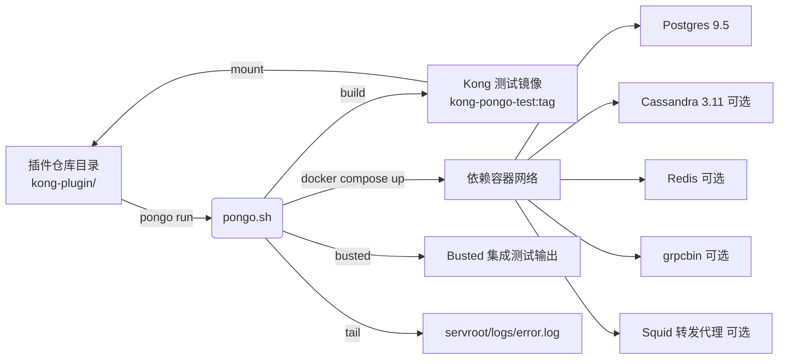
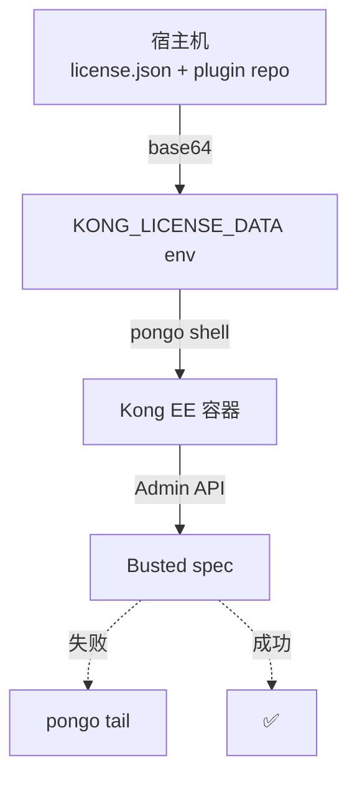

## 前言

为 Kong 写 Lua 插件时，真正的难点不是插件逻辑本身，而是 **"如何在一台本地机器上、把插件代码塞进一个跟生产一致的 Kong 环境里、跑 Busted 集成测试"**。Kong 官方给出的答案是 [kong-pongo](https://github.com/Kong/kong-pongo)（Apache-2.0，当前 v2.29.0，171 stars）：一条 `pongo run` 命令把 Kong 测试镜像、依赖容器、Busted 跑测、调试入口、日志尾随全部封装起来。

本文按 **"是什么 / 为什么 / 怎么用 / 什么时候用"** 四块拆解，先讲清楚 Pongo 的架构边界，再落到安装、配置和五类典型场景，最后给出 CI 集成和升级回归的具体套路。

<!-- more -->

## 目录

1. [Pongo 是什么：从 kong-plugin 痛点到一条命令跑测](#pongo-是什么从-kong-plugin-痛点到一条命令跑测)
2. [为什么需要 Pongo：直接 docker run Kong 的隐性成本](#为什么需要-pongo直接-docker-run-kong-的隐性成本)
3. [Pongo 怎么用：架构、安装、依赖容器、配置](#pongo-怎么用架构安装依赖容器配置)
4. [什么时候用：五类典型场景](#什么时候用五类典型场景)
5. [CI 集成与升级回归最佳实践](#ci-集成与升级回归最佳实践)
6. [总结与替代方案](#总结与替代方案)

---

## Pongo 是什么：从 kong-plugin 痛点到一条命令跑测

`kong-pongo` 是 Kong 团队维护的 **插件级测试运行器**，仓库里只有一个 `pongo.sh` 脚本加若干 docker-compose 片段，但通过符号链接暴露成 `pongo` 命令，提供了完整的本地 + CI 测试生命周期。



**一句话定位**：Pongo = `kong-pongo-test` 镜像构建器 + `kong-pongo-network` 依赖容器编排 + `spec/` 目录 Busted 跑测封装 + 调试入口（`pongo shell / tail / logs`）。你写的是 `*.lua` 插件代码和 `spec/*_spec.lua` 测试代码，剩下都是 Pongo 的事。

注意一个关键边界：**Pongo 不是 Kong 的运行时替代品**。它不替代你生产部署 Kong 的方式（Docker、k8s、bare metal），它只关心 "把 Kong 启动起来用来跑 spec" 这件事。

---


## 为什么需要 Pongo：直接 docker run Kong 的隐性成本

理论上你完全可以 `docker run -v $PWD:/plugin kong:3.5 bash`，但实践中要面对六个隐性成本：

| 隐性成本 | 直接 docker run | Pongo |
|----------|----------------|-------|
| **Postgres 启动 + Kong migrations** | 自己写 compose、写 `wait-for-it` | `pongo up` 内置 healthcheck |
| **OpenResty/LuaRocks 路径** | kong 容器里 `luarocks install` 全局污染 | 测试镜像预装 + 每次干净环境 |
| **Busted + helpers** | 需要 `kong/spec/helpers` 路径写对 | Pongo 把 `kong-plugin/` 挂到 `/kong-plugin`，自动 source |
| **多版本矩阵** | 每改一次 `KONG_VERSION` 就要重 pull 镜像 | `KONG_VERSION=3.5.x pongo run` 一次切换 |
| **Enterprise license** | 手动 base64 注入 license.json | `KONG_LICENSE_DATA` 环境变量 |
| **调试** | `docker exec -it` 进容器翻日志 | `pongo shell` / `pongo tail` / `pongo logs` |

最容易被低估的是 **spec 测试基础设施**：Kong 的集成测试用 `helpers.start_kong()` 起真实 Kong 进程、对 Admin API 发请求、断言响应——这套 helpers 在 Kong 镜像里已经装好，但 host 上的 Busted 是看不到的。Pongo 的镜像构建逻辑保证这些 helpers 路径正确，否则你的 `require "spec.helpers"` 会直接 `module not found`。

另一个隐性成本是 **依赖容器生命周期管理**。Cassandra 启动慢、Postgres 升级时数据 schema 不兼容、Redis 6 与 Redis 7 在 cluster mode 下的语义差异——这些坑 Pongo 已经替你踩过，沉淀进 `POSTGRES=10`、`CASSANDRA=3.11`、`REDIS=6.2.6` 这些环境变量默认值里。

---

## Pongo 怎么用：架构、安装、依赖容器、配置

### 1. 安装：把 pongo.sh 暴露成命令

Pongo 不发布 npm/pip 包，安装就是 **clone + symlink**：

```bash
git clone https://github.com/Kong/kong-pongo.git
mkdir -p ~/.local/bin
ln -s $(realpath kong-pongo/pongo.sh) ~/.local/bin/pongo
echo 'export PATH=$PATH:~/.local/bin' >> ~/.zshrc
```

升级同样简单：`cd kong-pongo && git pull && git checkout $(git tag | sort -V | tail -1)`。符号链接指向 `pongo.sh` 主脚本，所有子命令都由它分发。

**前置依赖**：

- 容器运行时：`docker`（带 `docker compose` 或 `docker-compose`）或 `podman`（带 `podman-compose` + `aardvark-dns`，v2.29.0 起新增）
- `curl`、`realpath`（macOS 老版本需 `brew install coreutils`）
- Windows 走 Git-BASH 或 WSL2

### 2. 子命令全景

| 子命令 | 类别 | 作用 |
|--------|------|------|
| `pongo init` | Project | 生成 `.luacov`、`pongo-setup*.sh` 默认模板 |
| `pongo lint` | Project | 跑 LuaCheck |
| `pongo pack` | Project | `*.rockspec` → `*.rock` 打包（LuaRocks 发布） |
| `pongo run [args]` | Project | 跑 Busted，`--` 后透传 busted 选项 |
| `pongo shell` | Project | 直接进入 Kong 容器 shell |
| `pongo tail [file]` | Project | 跟踪 `servroot/logs/error.log` |
| `pongo build [--force]` | Environment | 构建/重建 Kong 测试镜像 |
| `pongo up` / `down` | Environment | 启停依赖容器 |
| `pongo restart` | Environment | `down + up` 快捷方式 |
| `pongo logs [-f svc]` | Environment | 依赖容器日志（`pongo logs -f postgres`） |
| `pongo status` | Environment | 网络/镜像/容器状态 |
| `pongo expose` | Environment | 把容器内端口暴露到宿主机 |
| `pongo docs` | Environment | 生成并打开 test-helper 文档 |
| `pongo clean / nuke` | Environment | 删容器 + 删镜像 |
| `pongo update` | Maintenance | 更新内嵌的 Kong 版本构建产物 |

最常用的是 **`pongo run`**——它隐式做了 build → up → busted → down（依赖默认保留）四件事。

### 3. 依赖容器：用 CLI flag 或 `.pongo/pongorc` 切换

Pongo 把 Postgres、Cassandra、Redis、grpcbin、Squid 设计成 **可插拔依赖**——通过 CLI flag 或 `.pongo/pongorc` 文件按插件需要启用：

```bash
# 默认只启动 Postgres；要 cassandra + redis 就加 flag
pongo run --cassandra --redis

# 或者在 .pongo/pongorc 里固化（一行一个 flag），每个 spec run 都自动应用
echo --redis >> .pongo/pongorc
echo --no-cassandra >> .pongo/pongorc
```

依赖语义速览：

| 依赖 | 默认 | 角色 | 启用方式 | 容器内访问地址 |
|------|------|------|----------|----------------|
| **Postgres** | ✅ 启用 | Kong 数据库（默认 9.5） | `--no-postgres` 关闭 | `postgres:5432` |
| **Cassandra** | ❌ | Kong 数据库（旧版） | `--cassandra` | `cassandra:9042` |
| **Redis** | ❌ | KV / 限流后端 | `--redis` | `redis:6379`（spec 用 `helpers.redis_host`） |
| **grpcbin** | ❌ | mock gRPC 后端 | `--grpcbin` | `grpcbin:9000`（h2c）/ `:9001`（h2+TLS） |
| **Squid** | ❌ | 转发代理 | `--squid` | `squid:3128`（`kong:king` basic auth，`.mockbin.org` 白名单） |

**版本通过环境变量控制**：`POSTGRES=10`、`CASSANDRA=3.11`、`REDIS=6.2.6`、`SQUID=...`。如果 Kong 插件代码里写了自定义依赖（如 Zipkin），可以在 `.pongo/<dep-name>.yml` 放一份 docker-compose 片段，Pongo 会自动 merge 进 `kong-pongo-network`。

### 4. 关键环境变量：版本切换、License、CA 证书

```bash
# Kong 版本——支持 'x' 通配 patch 位
KONG_VERSION=3.5.x          # 最新 3.5.x 补丁版
KONG_VERSION=stable         # 特殊标签 stable / stable-ee / dev / dev-ee
KONG_VERSION=3.5.x.x        # Enterprise 三位版本

# 本地镜像（绕过 pull）
KONG_IMAGE=kong-ee pongo run

# Enterprise license（base64 JSON）
export KONG_LICENSE_DATA=$(base64 -i license.json)

# 私有 CA 证书（公司内网 / 镜像仓库）
export PONGO_CUSTOM_CA_CERT=/path/to/ca-bundle.pem

# Docker Hub 限流规避（CI 推荐）
export DOCKER_USERNAME=... DOCKER_PASSWORD=...

# 代理/证书跳过（**慎用**）
export PONGO_INSECURE=true
```

### 5. 初始化脚本：宿主机 vs 容器内 hook

插件通常需要 `lua-resty-*` rock 依赖。Pongo 默认行为是扫描所有 `*.rockspec` 自动安装，但你可以用两个 hook 介入：

- **`.pongo/pongo-setup-host.sh`** — 在 Kong 容器启动 **之前** 在 **宿主机** 执行（不是 source）。适合 clone 大依赖（避免每次 CI 重 pull）、做 release tag 选择等。
- **`.pongo/pongo-setup.sh`** — 在 Kong 容器启动 **时** 在 **容器内** 被 source（用 `/bin/bash`）。适合 `make install`、调 luarocks path、调 Kong 启动参数等。

两个脚本都能拿到 `PONGO_COMMAND` 环境变量，知道当前是 `run`、`shell` 还是 `up`。

```bash
# 示例：pongo-setup-host.sh 在宿主机预拉私有依赖
#!/usr/bin/env bash
if [ ! -d my_dependency ]; then
  git clone https://github.com/myorg/my_dependency.git
fi

# 示例：pongo-setup.sh 在容器内编译装 rock
#!/usr/bin/env bash
cd /kong-plugin/my_dependency && make install
/pongo/default-pongo-setup.sh   # 别忘了手动跑默认 rockspec 安装
```

---

## 什么时候用：五类典型场景

### 场景 1：本地为 Kong 插件跑 Busted 集成测试

**最常见用法**。从模板起一个插件仓库：

```bash
git clone https://github.com/wssaidong/kong-my-plugin
cd kong-my-plugin
pongo run                       # 自动 pull 镜像、起 Postgres、跑 spec/
pongo run ./spec/01-auth_spec.lua   # 只跑单个 spec
KONG_VERSION=3.5.x pongo run -- -v -o gtest ./spec    # busted 透传 verbose + gtest 输出
```

vs. 裸 docker 的对比见上表 §2。**适用边界**：只要你的 spec 用 `spec/helpers.start_kong()` 起 Kong 进程，Pongo 就直接适用。

### 场景 2：CI 中跑 Kong 插件测试（GitHub Actions）

kong-pongo 提供官方 [kong-pongo-action](https://github.com/Kong/kong-pongo-action)，一条 step 搞定：

```yaml
# .github/workflows/test.yml
name: "Test"
on: [pull_request, push]
jobs:
  test:
    runs-on: ubuntu-latest
    strategy:
      fail-fast: false
      matrix:
        kongVersion: ["2.8.x", "3.5.x", "dev"]
    steps:
      - uses: actions/checkout@v4
      - uses: Kong/kong-pongo-action@v1
        with:
          pongo_version: master
          kong_version: ${{ matrix.kongVersion }}
          license: ${{ secrets.KONG_LICENSE_DATA }}   # EE 测试用
      - run: pongo run
```

矩阵里加 `dev` / `dev-ee`（需 `GITHUB_TOKEN`）能让上游 nightly 构建每天回归一次。`schedule: cron: '0 0 * * *'` 是惯例。

### 场景 3：多 Kong 版本兼容矩阵

插件要兼容 Kong 2.x、3.x、3.5.x、EE、OSS？传统做法是写一堆 docker-compose 文件。Pongo 用 `KONG_VERSION` 一个变量搞定：

```bash
# 验证 3.5.x 全补丁系列
KONG_VERSION=3.5.0 pongo run
KONG_VERSION=3.5.1 pongo run
KONG_VERSION=3.5.2 pongo run

# 跨 major
KONG_VERSION=2.8.x pongo run
KONG_VERSION=3.5.x pongo run
KONG_VERSION=3.9.x pongo run

# Enterprise 同步
KONG_VERSION=3.5.x.x pongo run   # 3.5.0.0 / 3.5.1.0 / ...
```

`x` 通配 patch 位让 CI 总是跑最新补丁，避免 nightly 漏洞。配合 GitHub Actions matrix，单 PR 自动跑 5+ 版本组合是常见做法。

### 场景 4：Kong Enterprise 插件本地联调

EE 插件（如 rate-limiting-advanced、key-auth-enc、session）需要 license + Enterprise-only 配置。Pongo 让这一切在本地就能跑：

```bash
# 拉 EE 镜像并注入 license
export KONG_LICENSE_DATA=$(base64 -i ~/license.json)
export KONG_VERSION=3.5.x.x
pongo up --redis           # EE 插件通常需要 Redis
pongo shell                # 进 Kong 容器手动 curl Admin API
pongo tail                 # 跟 error.log
```

常见 EE 插件 Pongo 用法：

- **rate-limiting-advanced**：`--redis` + `pongo run ./spec/01-cluster_spec.lua`
- **session**：自动装 `lua-resty-session` rock
- **key-auth-enc**：需 Postgres + 自定义秘钥
- **mtls-auth**：把 `.pongo/certs/` 挂到容器测试



### 场景 5：Kong 升级、底层依赖变化时的回归验证

OpenResty 升级、LuaRocks 切换、Kong 主版本跃迁——这些"非自己代码"的变化最容易让旧插件沉默地坏掉。Pongo 让回归成本接近零：

```bash
# 旧插件仓库，验证新 Kong 是否还能跑通
cd ~/work/my-kong-plugin
KONG_VERSION=3.9.0 pongo run           # 跑当前默认 spec
KONG_VERSION=3.9.0 pongo run -- -v     # verbose 看 warning/deprecation

# 临时跑全部 spec（含集成）
KONG_VERSION=3.9.0 pongo run ./spec

# 想测 nightly dev 构建
KONG_VERSION=dev pongo run
```

配套技巧：

- 用 `pongo init` 生成 `.luacov`，`pongo run -- --coverage` 出覆盖率报告（仅 unit，集成测因 OpenResty 限制 LuaCov 不报）
- 跑 spec 前 `pongo clean && pongo build --force` 强制重建测试镜像，避免缓存掩盖问题
- CI 里加 cron job `schedule: '0 0 * * *'` 跑 nightly 回归
- 当 Kong 升级 changelog 提到 PDK 变化时，搜自己插件里 `kong.*` 调用，确认 `helpers.start_kong` 仍能 init

---

## CI 集成与升级回归最佳实践

### GitHub Actions 完整模板

```yaml
# .github/workflows/test.yml
name: "Kong Plugin Tests"
on:
  pull_request: {}
  push:
    branches: [master]
  schedule:
    - cron: '0 0 * * *'    # nightly dev build 回归

concurrency:
  group: ${{ github.workflow }} ${{ github.ref }}
  cancel-in-progress: ${{ github.event_name == 'pull_request' }}

jobs:
  test:
    runs-on: ubuntu-latest
    strategy:
      fail-fast: false
      matrix:
        kongVersion: ["2.8.x", "3.5.x", "dev"]
    env:
      DOCKER_USERNAME: ${{ secrets.DOCKER_USERNAME }}
      DOCKER_PASSWORD: ${{ secrets.DOCKER_PASSWORD }}
      KONG_LICENSE_DATA: ${{ secrets.KONG_LICENSE_DATA }}
    steps:
      - uses: actions/checkout@v4
      - uses: Kong/kong-pongo-action@v1
        with:
          pongo_version: master
          kong_version: ${{ matrix.kongVersion }}
      - run: pongo run
      - if: matrix.kongVersion == '3.5.x'
        run: pongo run -- --coverage
        continue-on-error: true   # LuaCov 集成测限制已知
```

要点：

- **fail-fast: false**：单个 Kong 版本失败不要让其他版本短路
- **Docker Hub credentials**：避免 CI 频繁限流拉镜像失败
- **schedule**：nightly 把上游 master 拉进矩阵，捕获 breaking change
- **matrix 优先级**：先跑最快的版本（`dev`）还是 LTS（`3.5.x`）取决于团队节奏

### 调试技巧速查

| 症状 | 命令 |
|------|------|
| Kong 启动失败但 spec 没报原因 | `pongo shell` → `/usr/local/bin/kong start` |
| 想看 nginx error.log | `pongo tail`（默认 `servroot/logs/error.log`） |
| 依赖容器起不来 | `pongo logs -f postgres` |
| 缓存的镜像有怪行为 | `pongo clean && pongo build --force` |
| 想从宿主机访问 Kong Admin | `pongo expose`（把 8001/8444 映射到 host） |
| CI 偶发镜像拉取失败 | 设 `DOCKER_USERNAME/DOCKER_PASSWORD` |
| 自定义依赖要进网络 | 在 `.pongo/<name>.yml` 加 compose 片段 |

### Pongo 的已知边界

1. **Podman + rootless**：插件目录必须由运行 Podman 的用户拥有，否则容器里显示成 `nobody`，Kong 写 `servroot` 失败。
2. **macOS + Podman**：`podman machine` 跑在 VM 里，bind-mount 和 host-gateway 语义与 Docker 不同，Pongo README 明示未测试。
3. **Pongo-in-Docker**：仅支持 Docker，不支持 Podman（因为挂 docker.sock）。
4. **LuaCov 集成测不报覆盖率**：受 OpenResty 限制，仅 unit 有效。
5. **依赖 healthcheck 失效**：`HEALTH_TIMEOUT=0` 可绕过自定义依赖，但 Docker Compose/Podman 对 `${VAR:-false}` 的插值语义不同（podman-compose 把任何非空字符串当 true）。

---

## 总结与替代方案

**Pongo 的本质**：把"为 Kong 插件跑集成测试"这件事封装成一个跟 Kong 主版本兼容矩阵紧密耦合的本地+CI 工具链。它不是通用测试 runner（pytest、jest 那种），也不是 Kong 替代品，而是 Kong 插件作者专属的脚手架。

**什么时候不用 Pongo**：

| 场景 | 更合适的方案 |
|------|------------|
| 不是 Kong 插件，只是普通 Lua 项目 | 直接用 luarocks + busted |
| 测试 Go/JS 插件（Kong 3.x 支持） | 各语言的官方 test runner |
| 需要模拟大规模生产集群 | terraform / kind + Kong in k8s |
| 不写 spec 只 smoke test | `curl` + docker run Kong |

**什么时候必须用 Pongo**：

- 你写的是 Kong Lua 插件
- spec 用 `helpers.start_kong()` 起真实 Kong 进程
- 需要在多个 Kong 版本上验证
- 团队已有 GitHub Actions / Jenkins CI
- 想避免每次重新拼装 Postgres + Kong + Busted

**长期价值**：Pongo 已经成为 Kong 插件生态的事实标准——kong-plugin 模板仓库、Kong 官方文档、所有 EE 插件仓库的 CI 都用它。如果你在 2026 年维护 Kong Lua 插件，Pongo 不是"一个选择"，而是默认起点。

---

## 参考资料

- [Kong/kong-pongo GitHub 仓库](https://github.com/Kong/kong-pongo) — v2.29.0，Apache-2.0
- [Kong 官方博客：自定义 Lua 插件开发](https://konghq.com/blog/custom-lua-plugin-kong-gateway)
- [Kong/kong-pongo-action](https://github.com/Kong/kong-pongo-action) — GitHub Actions 集成
- [Busted Lua 测试框架](https://lunarmodules.github.io/busted/)
- Kong 内部依赖 `kong/spec/helpers` 模块（`helpers.start_kong()`、`helpers.postgres_host` 等）

